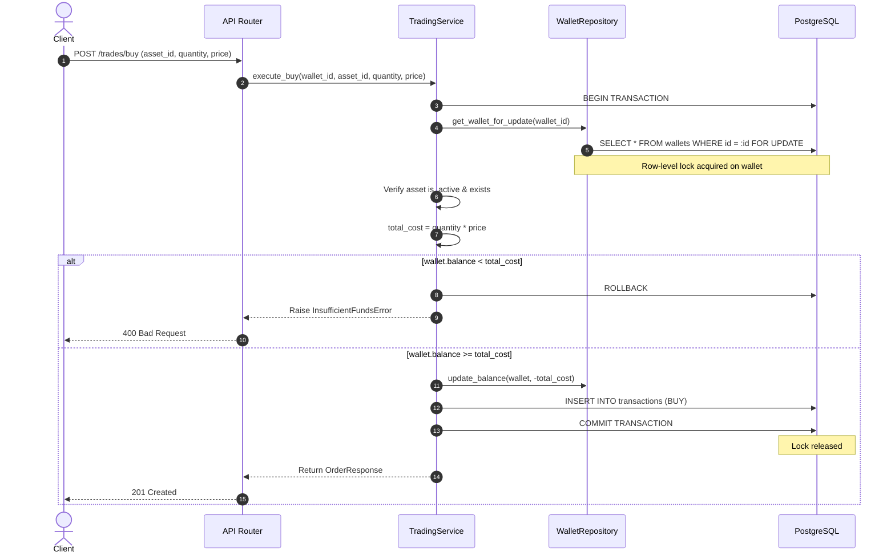

# AlgoTrade Pro – Trading Engine Architectural Design & Integration Plan

**Component:** Trading Engine, Transaction Integrity, Concurrency, and Portfolio Aggregation  
**Feature Branch:** `feature/trading-engine`  
**Author:** Team Lead – Trading Engine  
**Status:** Approved for Phase 1 Baseline  

---

## 1. System Overview & Context

AlgoTrade Pro is an educational algorithmic trading simulator backend designed around asynchronous FastAPI, SQLAlchemy 2.0 (asyncio), PostgreSQL, and Pydantic v2.

The core responsibility of the **Trading Engine** is to:
1. Provide atomic, deterministic execution of simulated **BUY** and **SELL** orders.
2. Guarantee immutable transaction recording in the ledger (`transactions` table).
3. Protect wallet balances from race conditions using pessimistic row-level locking (`SELECT FOR UPDATE`).
4. Prevent negative balances and phantom executions.
5. Compute portfolio holdings and user transaction history accurately with exact `Decimal` precision.

---

## 2. Existing Repository Architecture Analysis

### 2.1 Database Models & Schema Baseline

The existing models define the foundational entities:

```
+--------------------+            +--------------------+
|       User         | 1        1 |       Wallet       |
|--------------------|------------|--------------------|
| id: UUID (PK)      |            | id: UUID (PK)      |
| email: str(255)    |            | user_id: UUID (FK) |
| password_hash: str |            | balance: Num(20,8) |
| created_at / upd   |            | currency: str(3)   |
+--------------------+            +--------------------+
                                            | 1
                                            |
                                            | *
+--------------------+            +--------------------+
|       Asset        | 1        * |    Transaction     |
|--------------------|------------|--------------------|
| id: UUID (PK)      |            | id: UUID (PK)      |
| symbol: str(20)    |            | wallet_id: UUID(FK)|
| name: str(150)     |            | asset_id: UUID(FK) |
| asset_type: str(30)|            | transaction_type   |
| currency: str(3)   |            | quantity: Num(24,8)|
| is_active: bool    |            | price: Num(24,8)   |
| created_at / upd   |            | total_amt: Num(28,8|
+--------------------+            | created_at (only)  |
                                  +--------------------+
```

### 2.2 Key Constraints Present in the Database

1. **Wallets:**
   - `ck_wallets_balance_non_negative`: `balance >= 0` (PostgreSQL CHECK constraint prevents negative balance at DB level).
   - `uq_wallets_user_id`: 1:1 relationship between User and Wallet.
   - Foreign key to `users.id` with `ondelete="RESTRICT"`.

2. **Transactions (Ledger):**
   - `ck_transactions_valid_transaction_type`: `transaction_type IN ('BUY', 'SELL')`.
   - `ck_transactions_quantity_positive`: `quantity > 0`.
   - `ck_transactions_price_positive`: `price > 0`.
   - `ck_transactions_total_amount_positive`: `total_amount > 0`.
   - `ck_transactions_total_amount_matches_quantity_price`: `total_amount = quantity * price`.
   - Foreign keys to `wallets.id` and `assets.id` with `ondelete="RESTRICT"`.
   - Append-only design: Contains `created_at` but no `updated_at`.

---

## 3. Trading Engine Architectural Design

### 3.1 Directory & Module Placement

The Trading Engine fits cleanly into the established modular repository structure:

```text
src/
├── api/
│   └── v1/
│       ├── trading.py          <-- BUY/SELL order endpoints, transaction history
│       └── portfolio.py        <-- Portfolio summary and positions endpoint
├── schemas/
│   ├── trading.py              <-- Pydantic v2 schemas: OrderCreate, OrderResponse, TradeType
│   └── portfolio.py            <-- PortfolioHolding, PortfolioSummary schemas
├── services/
│   ├── trading_service.py      <-- Core execution engine: buy/sell validation, locking, balance update
│   └── portfolio_service.py    <-- Position aggregation from transaction ledger
├── repositories/
│   ├── trading_repository.py   <-- DB queries: insert transaction, fetch transaction history
│   └── wallet_repository.py    <-- DB queries: get wallet with row lock, update balance
└── core/
    ├── config.py               <-- Application settings
    └── database.py             <-- Async engine and session generator (get_db)
```

---

## 4. Concurrency & Locking Strategy

To ensure strict transaction integrity and prevent race conditions (such as double spending via parallel requests):



### 4.1 Row-Level Lock Semantics
- Use `with_for_update()` in SQLAlchemy on the `Wallet` record inside the active transaction.
- Any subsequent concurrent request targeting the same wallet will wait until the first transaction commits or rolls back.
- If balance is insufficient, the transaction is cleanly aborted with no ledger records created.

---

## 5. Potential Integration Risks & Mitigations

| Risk | Description | Mitigation Strategy |
|---|---|---|
| **Floating Point Inaccuracy** | Using standard `float` for prices or quantities will lead to rounding errors and violate the DB constraint `total_amount = quantity * price`. | Strictly enforce `Decimal` with explicit quantizing (up to 8 decimal places) in Pydantic schemas and service layers. |
| **Deadlocks on Concurrent Multi-Asset Trades** | If orders lock multiple resources out of order, deadlocks can occur under high concurrency. | Enforce consistent lock acquisition order: Always lock the `Wallet` first; acquire read-only asset status without locking. |
| **Ghost Holdings on Sell** | Selling assets without verifying ledger holdings could lead to negative asset positions. | Aggregate historical transactions for the wallet (`SUM(BUY) - SUM(SELL)`) inside the locked transaction before permitting a `SELL`. |
| **Unbounded Session Leaks** | Forgetting to commit/rollback or close sessions under error conditions exhausts connection pools. | Rely strictly on `async with session.begin():` or standardized session lifecycle management. |

---

## 6. Implementation Phasing Compliance

All implementation will strictly adhere to the 7-phase roadmap:
- **Phase 1:** Repository Analysis & Architecture Baseline (Days 1–2)
- **Phase 2:** Pydantic v2 Schemas & Rigorous Validation (Days 3–5)
- **Phase 3:** Buy Operation Implementation (Days 6–8)
- **Phase 4:** Sell Operation Implementation (Days 9–11)
- **Phase 5:** Transaction Integrity & Concurrency Control (Days 12–14)
- **Phase 6:** Portfolio & Transaction History Integration (Days 15–17)
- **Phase 7:** End-to-End Testing & Final Integration (Days 18–20)

