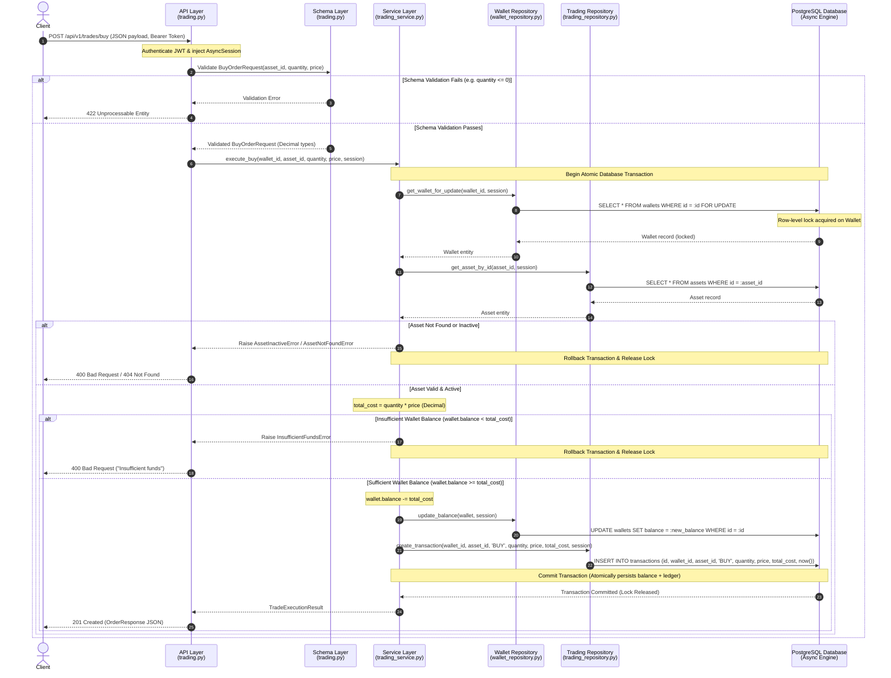
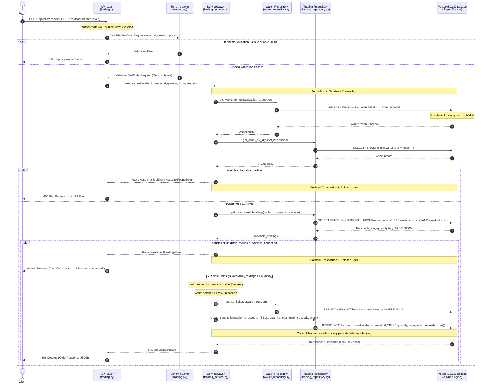

# AlgoTrade Pro – Trading Engine Architectural Design & Integration Plan

**Component:** Trading Engine, Transaction Integrity, Concurrency, and Portfolio Aggregation
**Feature Branch:** `feature/trading-engine`
**Base Branch:** `main`
**Author:** Team Lead – Trading Engine
**Status:** Approved Architecture Baseline (Phase 1 – Day 2 Tasks 1 & 2)

---

## 1. System Overview & Context

AlgoTrade Pro is an educational algorithmic trading simulator backend designed around asynchronous FastAPI, SQLAlchemy 2.0 (asyncio), PostgreSQL, and Pydantic v2.

The core responsibility of the **Trading Engine** is to:
1. Provide deterministic, atomic execution of simulated **BUY** and **SELL** orders.
2. Guarantee immutable transaction recording in the append-only ledger (`transactions` table).
3. Protect wallet balances and portfolio holdings from race conditions using pessimistic row-level locking (`SELECT FOR UPDATE`).
4. Prevent negative balances and phantom executions at both application and database levels.
5. Compute portfolio holdings and user transaction history accurately with exact `Decimal` precision.

---

## 2. Existing Repository Architecture Analysis

### 2.1 Database Models & Schema Baseline

The existing models define the foundational entities:

```
+--------------------+            +--------------------+
|       User         | 1        1 |       Wallet       |
|--------------------|------------|--------------------|
| id: UUID (PK)      |            | id: UUID (PK)      |
| email: str(255)    |            | user_id: UUID (FK) |
| password_hash: str |            | balance: Num(20,8) |
| created_at / upd   |            | currency: str(3)   |
+--------------------+            +--------------------+
                                            | 1
                                            |
                                            | *
+--------------------+            +--------------------+
|       Asset        | 1        * |    Transaction     |
|--------------------|------------|--------------------|
| id: UUID (PK)      |            | id: UUID (PK)      |
| symbol: str(20)    |            | wallet_id: UUID(FK)|
| name: str(150)     |            | asset_id: UUID(FK) |
| asset_type: str(30)|            | transaction_type   |
| currency: str(3)   |            | quantity: Num(24,8)|
| is_active: bool    |            | price: Num(24,8)   |
| created_at / upd   |            | total_amt: Num(28,8|
+--------------------+            | created_at (only)  |
                                  +--------------------+
```

### 2.2 Key Constraints Present in the Database

1. **Wallets (`wallets` table):**
   - `ck_wallets_balance_non_negative`: `balance >= 0` (PostgreSQL CHECK constraint prevents negative balance at DB level).
   - `uq_wallets_user_id`: 1:1 relationship between User and Wallet.
   - Foreign key to `users.id` with `ondelete="RESTRICT"`.

2. **Transactions (`transactions` table - Immutable Ledger):**
   - `ck_transactions_valid_transaction_type`: `transaction_type IN ('BUY', 'SELL')`.
   - `ck_transactions_quantity_positive`: `quantity > 0`.
   - `ck_transactions_price_positive`: `price > 0`.
   - `ck_transactions_total_amount_positive`: `total_amount > 0`.
   - `ck_transactions_total_amount_matches_quantity_price`: `total_amount = quantity * price`.
   - Foreign keys to `wallets.id` and `assets.id` with `ondelete="RESTRICT"`.
   - Append-only design: Inherits from `Base` with `created_at` only; no `updated_at`.

3. **Assets (`assets` table):**
   - `symbol`: Unique index (`ix_assets_symbol`), max 20 chars.
   - `is_active`: Boolean flag controlling tradability.

---

## 3. Layer-by-Layer Architectural Responsibilities

The Trading Engine adheres to a strict layered architecture with clean separation of concerns, unidirectional dependencies, and explicit boundaries:

```
[ HTTP Client / Frontend ]
          │
          ▼
┌────────────────────────────────────────────────────────┐
│ 1. API Layer (src/api/)                                │
│    - Endpoints, Routing, Status Codes                  │
│    - Dependency Injection (get_db, Auth)               │
│    - HTTP Exception Translation                        │
└───────────────────────┬────────────────────────────────┘
                        │ Validated Schemas
                        ▼
┌────────────────────────────────────────────────────────┐
│ 2. Schema Layer (src/schemas/)                         │
│    - Pydantic v2 Request & Response Models             │
│    - Exact Decimal Parsing & Quantization              │
│    - Field Validation (>0, scale <= 8)                 │
└───────────────────────┬────────────────────────────────┘
                        │ Typed Parameters / Payloads
                        ▼
┌────────────────────────────────────────────────────────┐
│ 3. Service Layer (src/services/)                       │
│    - Core Business Logic & Orchestration               │
│    - Atomic Transaction Boundary (session.begin())     │
│    - Pre-condition Checks (Funds, Holdings, Active)    │
│    - Concurrency Coordination via Row Locks            │
└───────────────────────┬────────────────────────────────┘
                        │ ORM Entities & Queries
                        ▼
┌────────────────────────────────────────────────────────┐
│ 4. Repository Layer (src/repositories/)                │
│    - SQLAlchemy 2.0 Async Query Construction           │
│    - Row Locking: SELECT ... FOR UPDATE                │
│    - Ledger Insertions & Historical Aggregations       │
└───────────────────────┬────────────────────────────────┘
                        │ AsyncPG Sockets
                        ▼
┌────────────────────────────────────────────────────────┐
│ 5. Database Layer (src/models/ & src/core/database.py) │
│    - PostgreSQL Database Engine & Connection Pool      │
│    - Declarative ORM Models & Table Schemas            │
│    - Check Constraints & Relational Integrity          │
└────────────────────────────────────────────────────────┘
```

### 3.1 API Layer (`src/api/` / `src/api/v1/trading.py`)
- **Primary Responsibility:** Exposing RESTful HTTP endpoints for trading operations and serving as the external interface of the backend.
- **Specific Duties:**
  - Route definitions: `POST /api/v1/trades/buy`, `POST /api/v1/trades/sell`, `GET /api/v1/trades/history`.
  - Resolving dependencies: Injecting the async database session via `Depends(get_db)` and obtaining authenticated user identity / wallet context via JWT security dependencies.
  - Request deserialization and input binding to Pydantic v2 schemas.
  - HTTP status code mapping: Returning `201 Created` for successful trades, `200 OK` for history queries, `400 Bad Request` for business rule violations (insufficient funds, insufficient holdings, inactive asset), `404 Not Found` for missing resources, and `422 Unprocessable Entity` for schema validation failures.
  - Exception translation: Catching domain-specific exceptions raised by the service layer (e.g., `InsufficientFundsError`, `InsufficientHoldingsError`, `AssetInactiveError`, `AssetNotFoundError`, `WalletNotFoundError`) and converting them into structured RFC 7807 problem details or clean JSON error responses.
- **Strict Boundary:** The API layer contains **zero** direct database queries and **zero** trade execution logic. It delegates all operational decisions directly to the Service Layer.

### 3.2 Schema Layer (`src/schemas/` / `src/schemas/trading.py`)
- **Primary Responsibility:** Enforcing contract validation, data serialization, and financial precision formatting for all incoming requests and outgoing responses.
- **Specific Duties:**
  - Defining Pydantic v2 schemas: `BuyOrderRequest`, `SellOrderRequest`, `OrderResponse`, `TransactionDetailResponse`, and `TradeType` enum (`BUY`, `SELL`).
  - Strict type enforcement: Ensuring all monetary and quantitative amounts (`quantity`, `price`, `total_amount`) use Python's `Decimal` type. Floating-point numbers are strictly prohibited to prevent loss of precision.
  - Field-level validation:
    - `quantity`: Must be strictly greater than zero (`gt=0`), with a maximum scale of 8 decimal places.
    - `price`: Must be strictly greater than zero (`gt=0`), with a maximum scale of 8 decimal places.
    - `asset_id`: Must be a valid UUID.
  - String sanitization: Trimming leading/trailing whitespace and standardizing symbols where applicable.
  - Serialization: Formatting timestamp fields (`created_at`) as ISO 8601 strings and serializing `Decimal` values cleanly for client consumption.
- **Strict Boundary:** Schemas do not communicate with the database or execute business rules; they validate shape, types, and mathematical invariants of inputs before service execution.

### 3.3 Service Layer (`src/services/` / `src/services/trading_service.py`)
- **Primary Responsibility:** Orchestrating the core trading business logic, defining database transaction boundaries, and guaranteeing ACID transactional integrity.
- **Specific Duties:**
  - **Transaction Boundary Management:** Wrapping each order execution within an atomic database transaction context (`async with session.begin():`). If any check fails or an unexpected exception occurs, the transaction automatically rolls back, leaving no orphaned state.
  - **Concurrency Coordination:** Requesting pessimistic row-level locking from the repository layer (`get_wallet_for_update`) to serialize concurrent trades targeting the same wallet.
  - **Pre-trade Business Validations:**
    - Verifying the targeted asset exists and is tradable (`is_active == True`).
    - Computing the exact transaction cost/proceeds using `Decimal`: `total_amount = quantity * price`.
    - **For Buy Operations:** Checking `wallet.balance >= total_amount`. If balance is insufficient, raising `InsufficientFundsError`.
    - **For Sell Operations:** Querying user's net holdings for the asset from the ledger (`total_bought - total_sold`) and checking `available_holdings >= quantity`. If holdings are insufficient, raising `InsufficientHoldingsError`.
  - **State Mutation:** Orchestrating the wallet balance update (`wallet.balance -= total_cost` for buy; `wallet.balance += total_proceeds` for sell) and creating the append-only ledger `Transaction` record.
  - **Event / Audit Logging:** Preparing structured execution results to return to the API layer.
- **Strict Boundary:** The Service layer never writes raw SQL or interacts directly with the database driver; it accesses persistence exclusively through the Repository Layer.

### 3.4 Repository Layer (`src/repositories/` / `src/repositories/wallet_repository.py`, `src/repositories/trading_repository.py`)
- **Primary Responsibility:** Isolating all data access logic, executing SQLAlchemy 2.0 async queries, and managing entity persistence.
- **Specific Duties:**
  - **Pessimistic Row Locking:** Implementing `SELECT ... FROM wallets WHERE id = :id FOR UPDATE` via SQLAlchemy's `.with_for_update()` to ensure exclusive row access during balance mutations.
  - **Ledger Ingestion:** Persisting new immutable `Transaction` entities into the `transactions` table.
  - **Holdings Calculation Queries:** Performing ledger aggregation queries to compute net held quantities:
    ```sql
    SELECT COALESCE(SUM(
        CASE
            WHEN transaction_type = 'BUY' THEN quantity
            WHEN transaction_type = 'SELL' THEN -quantity
            ELSE 0
        END
    ), 0)
    FROM transactions
    WHERE wallet_id = :wallet_id AND asset_id = :asset_id;
    ```
  - **Ledger History Queries:** Fetching paginated transaction records filtered by `wallet_id`, `asset_id`, and date ranges, ordered chronologically.
  - **Asset Retrieval:** Querying `Asset` records by ID or symbol.
- **Strict Boundary:** Repositories do not make business rule determinations and **never** commit or rollback transactions independently. They operate strictly within the `AsyncSession` provided by the Service.

### 3.5 Database Layer (SQLAlchemy Models & Async Infrastructure)
- **Primary Responsibility:** Physical data persistence, enforcing relational integrity, executing row locks, and guaranteeing database-level invariants.
- **Specific Duties:**
  - Managing connection pooling via `create_async_engine` and `AsyncSessionLocal` (`expire_on_commit=False`, `autoflush=False`).
  - Enforcing schema-level check constraints:
    - `balance >= 0` on `wallets`.
    - `quantity > 0`, `price > 0`, `total_amount > 0`, `total_amount = quantity * price`, and `transaction_type IN ('BUY', 'SELL')` on `transactions`.
  - Enforcing foreign key constraints with `RESTRICT` on delete to protect transaction ledger auditability.
  - Providing the row-level locking mechanism (`FOR UPDATE`) in PostgreSQL.

---

## 4. Buy Operation Architecture & Sequence Diagram

### 4.1 Step-by-Step Execution Lifecycle

1. **Client Request:** The client sends an authenticated HTTP `POST` request to `/api/v1/trades/buy` with payload `{"asset_id": "<UUID>", "quantity": "10.00000000", "price": "150.25000000"}`.
2. **Authentication & Session Injection:** FastAPI verifies the JWT access token, extracts the user/wallet identity, and invokes `get_db()` to provide an active `AsyncSession`.
3. **Schema Validation:** The request payload is parsed by `BuyOrderRequest`. Pydantic validates that `quantity > 0`, `price > 0`, values are valid `Decimal`, and precision does not exceed 8 decimal places.
4. **Service Dispatch:** The API router invokes `TradingService.execute_buy(wallet_id, asset_id, quantity, price, session)`.
5. **Transaction Initialization:** The service initiates an atomic transaction block: `async with session.begin():`.
6. **Acquire Row-Level Lock:** The service invokes `WalletRepository.get_wallet_for_update(wallet_id, session)`. PostgreSQL executes `SELECT * FROM wallets WHERE id = :id FOR UPDATE`, blocking any concurrent transactions attempting to modify this wallet.
7. **Asset Validation:** The service queries the asset via `TradingRepository.get_asset_by_id(asset_id, session)`. If the asset does not exist, `AssetNotFoundError` is raised; if `asset.is_active` is `False`, `AssetInactiveError` is raised.
8. **Cost Calculation:** The service computes `total_cost = quantity * price` using exact `Decimal` arithmetic.
9. **Balance Verification:**
   - **Case A (Insufficient Funds):** If `wallet.balance < total_cost`, the service raises `InsufficientFundsError`. The transaction context exits, triggering an automatic `ROLLBACK`. The API layer catches the error and returns HTTP `400 Bad Request`.
   - **Case B (Sufficient Funds):** If `wallet.balance >= total_cost`, execution proceeds.
10. **Balance Deduction:** The service decrements the wallet's balance: `wallet.balance -= total_cost` via `WalletRepository.update_balance()`.
11. **Ledger Record Creation:** The service instantiates a new `Transaction` entity (`transaction_type="BUY"`, `quantity=quantity`, `price=price`, `total_amount=total_cost`) and saves it via `TradingRepository.create_transaction()`.
12. **Transaction Commit:** The `session.begin()` block completes successfully, committing the balance deduction and ledger record simultaneously. The PostgreSQL row lock is released.
13. **Response Serialization:** The service returns a domain trade result, which the API router serializes into `OrderResponse` and returns to the client with HTTP `201 Created`.

### 4.2 Buy Operation Sequence Diagram



---

## 5. Sell Operation Architecture & Sequence Diagram

### 5.1 Step-by-Step Execution Lifecycle

1. **Client Request:** The client sends an authenticated HTTP `POST` request to `/api/v1/trades/sell` with payload `{"asset_id": "<UUID>", "quantity": "5.00000000", "price": "155.00000000"}`.
2. **Authentication & Session Injection:** FastAPI authenticates the user, extracts the wallet context, and provides the async database session.
3. **Schema Validation:** The payload is validated by `SellOrderRequest` ensuring `quantity > 0`, `price > 0`, and strict `Decimal` representation.
4. **Service Dispatch:** The API router calls `TradingService.execute_sell(wallet_id, asset_id, quantity, price, session)`.
5. **Transaction Initialization:** The service opens an atomic transaction block: `async with session.begin():`.
6. **Acquire Row-Level Lock:** The service locks the wallet via `WalletRepository.get_wallet_for_update(wallet_id, session)` (`SELECT ... FOR UPDATE`), serializing any other simultaneous trades for this wallet.
7. **Asset Validation:** The service confirms the asset exists and is active (`is_active == True`).
8. **Holdings Verification:**
   - The service queries net asset holdings via `TradingRepository.get_user_asset_holdings(wallet_id, asset_id, session)`.
   - The repository executes a SQL aggregation summing all prior `BUY` quantities and subtracting all prior `SELL` quantities for that specific wallet and asset.
   - **Case A (Insufficient Holdings):** If `available_holdings < quantity`, the user is attempting to sell assets they do not own. The service raises `InsufficientHoldingsError`. The transaction rolls back, releasing the lock, and the API returns HTTP `400 Bad Request`.
   - **Case B (Sufficient Holdings):** If `available_holdings >= quantity`, execution proceeds.
9. **Proceeds Calculation:** The service computes `total_proceeds = quantity * price` using exact `Decimal` arithmetic.
10. **Balance Credit:** The service increments the wallet balance: `wallet.balance += total_proceeds` via `WalletRepository.update_balance()`.
11. **Ledger Record Creation:** The service creates an immutable `Transaction` record (`transaction_type="SELL"`, `quantity=quantity`, `price=price`, `total_amount=total_proceeds`) and inserts it via `TradingRepository.create_transaction()`.
12. **Transaction Commit:** The database transaction commits atomically. Both the credit to the wallet balance and the append-only sell transaction are permanently written. The row lock is released.
13. **Response Serialization:** The router serializes the result into `OrderResponse` and returns HTTP `201 Created` to the client.

### 5.2 Sell Operation Sequence Diagram



---

## 6. Request & Response Lifecycle Across Architectural Boundaries

The table below illustrates how a trading request transforms as it travels across each layer boundary, and how data types are mapped between layers:

| Boundary | Inbound Data Structure | Responsibility at Boundary | Outbound Data Structure |
|---|---|---|---|
| **Client ➔ API Layer** | HTTP Request (Raw JSON string + Authorization Header) | FastAPI extracts path/body, verifies Bearer token, initiates DB session dependency (`get_db`). | Raw dictionary payload |
| **API Layer ➔ Schema Layer** | Raw dictionary payload | Pydantic v2 model parses strings into `UUID` and `Decimal`. Validates `gt=0`, scale `<= 8`. | Validated `BuyOrderRequest` / `SellOrderRequest` |
| **API Layer ➔ Service Layer** | Validated Pydantic schema + `AsyncSession` + `wallet_id` | Router calls `TradingService` method. Service begins transaction context (`session.begin()`). | Typed parameters (`UUID`, `Decimal`, `AsyncSession`) |
| **Service Layer ➔ Repository Layer** | Entity identifiers (`wallet_id`, `asset_id`), `Decimal` quantities | Service issues query commands. Repository builds SQLAlchemy 2.0 async `select()` / `insert()` statements with `.with_for_update()`. | SQLAlchemy executable statements |
| **Repository Layer ➔ Database** | Compiled SQL statements via AsyncPG driver | PostgreSQL acquires row locks, checks constraints, commits changes or rolls back. | Raw database row tuples / lock acknowledgements |
| **Database ➔ Repository Layer** | Raw PostgreSQL tuples | AsyncPG maps rows to SQLAlchemy ORM model instances (`Wallet`, `Asset`, `Transaction`). | ORM instances (`Wallet`, `Transaction`) |
| **Repository Layer ➔ Service Layer** | ORM model instances / scalar Decimal aggregations | Service evaluates business conditions, modifies entity attributes, and triggers commit. | Domain result entity / execution metadata |
| **Service Layer ➔ API Layer** | Domain trade result entity | Service returns successfully. Router converts result into schema response. Handles domain exceptions. | `OrderResponse` Pydantic model |
| **API Layer ➔ Client** | `OrderResponse` Pydantic model | FastAPI serializes model to JSON and attaches HTTP status code (`201 Created`). | HTTP Response (JSON payload + status 201) |

---

## 7. Database Locking & Transaction Concurrency Strategy

This section provides the comprehensive database locking, transaction boundary, and concurrency control architecture for safe, deterministic concurrent trading.

### 7.1 Wallet Row-Level Locking (`SELECT FOR UPDATE`)

#### 7.1.1 Why Simultaneous Requests Cause Race Conditions (Lost Updates & Double-Spending)
In an asynchronous, multi-worker backend, two or more trade requests for the same wallet can arrive at nearly identical timestamps:
- **Scenario:** A user has a wallet balance of **$100.00**.
- **Concurrent Requests:** Request $A$ (Buy $80.00) and Request $B$ (Buy $80.00) execute simultaneously.
- **Race Condition without Locking:**
  1. Connection $A$ reads `balance = $100.00`. Checks $100 \ge 80$ (Pass).
  2. Connection $B$ reads `balance = $100.00` before Connection $A$ commits. Checks $100 \ge 80$ (Pass).
  3. Connection $A$ sets `balance = $100 - $80 = $20.00` and commits.
  4. Connection $B$ sets `balance = $100 - $80 = $20.00` (or $20 - 80 = -$60.00$) and commits.
  - **Outcome:** Either a **lost update** occurs (user spent $160 but balance is $20), or an integrity check failure (`ck_wallets_balance_non_negative`) crashes the request abruptly without graceful domain handling.

#### 7.1.2 Why PostgreSQL Pessimistic Row-Level Locking is Appropriate
1. **Row-Granularity:** `SELECT ... FOR UPDATE` acquires an exclusive lock strictly on the targeted `wallets` row. Trades executed by User X do not lock or delay trades executed by User Y.
2. **Deterministic Serialization:** Concurrent trade requests for the *same* wallet are queued sequentially by PostgreSQL's lock manager, eliminating race conditions before data evaluation begins.
3. **Avoidance of Optimistic Retry Churn:** In high-frequency algorithmic trading, optimistic concurrency control (version numbers) results in high abort rates under load. Pessimistic locking guarantees that waiting requests succeed in sequence if sufficient balance/holdings remain, without requiring application-level retry loops.
4. **PostgreSQL Read Committed Semantics:** In PostgreSQL's default `READ COMMITTED` isolation level, when a blocked `SELECT ... FOR UPDATE` query finally acquires the lock after the holding transaction commits, **it automatically re-evaluates the query using the newly committed row state**. This ensures the waiting transaction immediately sees the updated balance.

#### 7.1.3 SQLAlchemy 2.0 Implementation Pattern
In SQLAlchemy 2.0 async, row-level locking is requested using the `.with_for_update()` clause:

```python
# Illustrative repository pattern (src/repositories/wallet_repository.py)
from sqlalchemy import select
from sqlalchemy.ext.asyncio import AsyncSession
from src.models.wallet import Wallet

class WalletRepository:
    @staticmethod
    async def get_wallet_for_update(wallet_id: uuid.UUID, session: AsyncSession) -> Wallet | None:
        """
        Acquire an exclusive row-level lock on the specified wallet row.
        Executes: SELECT * FROM wallets WHERE id = :wallet_id FOR UPDATE
        """
        stmt = (
            select(Wallet)
            .where(Wallet.id == wallet_id)
            .with_for_update()
        )
        result = await session.execute(stmt)
        return result.scalar_one_or_none()
```

#### 7.1.4 Lock Lifecycle (Acquisition & Release)
- **Lock Acquisition:** The row lock is acquired when PostgreSQL executes the `SELECT ... FOR UPDATE` query via `await session.execute(stmt)` inside an active transaction.
- **Lock Hold Duration:** The lock is held exclusively by that database connection for the lifetime of the transaction.
- **Lock Release:** The lock is automatically released by PostgreSQL when the transaction finishes—either via `COMMIT` (successful completion) or `ROLLBACK` (error/exception).

#### 7.1.5 Handling Missing Wallet Records
If `result.scalar_one_or_none()` evaluates to `None`:
1. The service immediately raises a domain exception: `WalletNotFoundError(wallet_id)`.
2. The active transaction context exits cleanly, triggering an immediate `ROLLBACK`.
3. The API layer maps `WalletNotFoundError` to HTTP `404 Not Found` with a descriptive error payload.

---

### 7.2 Transaction Atomicity & Service Boundary

#### 7.2.1 Service-Owned Transaction Boundary (`async with session.begin():`)
The Service layer strictly owns the lifecycle of the database transaction. Every trade operation executes within a single async context manager:

```python
# Conceptual Service Layer Transaction Boundary (src/services/trading_service.py)
class TradingService:
    async def execute_buy(
        self,
        wallet_id: uuid.UUID,
        asset_id: uuid.UUID,
        quantity: Decimal,
        price: Decimal,
        session: AsyncSession,
    ) -> OrderResponse:
        # Atomic Transaction Boundary begins here:
        async with session.begin():
            # 1. Acquire pessimistic lock on wallet
            wallet = await self.wallet_repo.get_wallet_for_update(wallet_id, session)
            if wallet is None:
                raise WalletNotFoundError(wallet_id)

            # 2. Validate asset tradability
            asset = await self.trading_repo.get_asset_by_id(asset_id, session)
            if asset is None:
                raise AssetNotFoundError(asset_id)
            if not asset.is_active:
                raise AssetInactiveError(asset.symbol)

            # 3. Calculate exact cost and verify balance
            total_cost = quantity * price
            if wallet.balance < total_cost:
                raise InsufficientFundsError(available=wallet.balance, required=total_cost)

            # 4. Mutate wallet balance
            wallet.balance -= total_cost

            # 5. Persist immutable transaction ledger record
            transaction = Transaction(
                wallet_id=wallet.id,
                asset_id=asset.id,
                transaction_type="BUY",
                quantity=quantity,
                price=price,
                total_amount=total_cost,
            )
            await self.trading_repo.create_transaction(transaction, session)

        # Transaction COMMITS automatically when exiting the block without exceptions.
        # If any exception was raised, transaction ROLLS BACK automatically.
        return self._build_order_response(transaction)
```

#### 7.2.2 All-or-Nothing Operations
The following database modifications **must succeed or fail as a single atomic unit**:
1. **Wallet Balance Deduction or Credit:** Updating `wallets.balance`.
2. **Transaction Ledger Insertion:** Inserting the immutable record into `transactions`.
3. **Database Constraint Validations:** Ensuring `ck_wallets_balance_non_negative` and `ck_transactions_total_amount_matches_quantity_price` hold true.

*Failure Consequence:* If balance deduction succeeded without ledger insertion, user funds would disappear without an audit trail. If ledger insertion succeeded without balance deduction, free trades would occur. The atomic transaction boundary guarantees this split-state anomaly is physically impossible.

#### 7.2.3 Repository Non-Commit Rule
- **Rule:** Repositories (`WalletRepository`, `TradingRepository`) **must never** call `session.commit()` or `session.rollback()`.
- **Reason:** Repositories are purely data access providers. An atomic business operation spans multiple repository calls (locking wallet, reading asset, aggregating holdings, updating balance, inserting ledger entry). If a repository committed prematurely, partial updates would be permanently written to the database before subsequent validation steps execute, destroying ACID transaction guarantees.

---

### 7.3 Concurrency Scenarios & Execution Analysis

#### 7.3.1 Scenario 1: Two Simultaneous Buy Requests on One Wallet
- **Initial State:** `Wallet.balance = $100.00`.
- **Requests:** Trade 1 (Buy $70.00), Trade 2 (Buy $60.00) arrive concurrently.
- **Execution Flow:**
  1. Trade 1 enters `session.begin()` and issues `SELECT ... FROM wallets WHERE id = :id FOR UPDATE`. Lock is granted to Trade 1.
  2. Trade 2 enters `session.begin()` and issues `SELECT ... FROM wallets WHERE id = :id FOR UPDATE`. PostgreSQL detects existing exclusive lock and puts Trade 2 into `LockWait` state.
  3. Trade 1 evaluates: `balance ($100.00) >= cost ($70.00)` ➔ **Valid**.
  4. Trade 1 sets `balance = $30.00`, inserts `BUY` transaction record, and exits `session.begin()`.
  5. Trade 1 **COMMITS**. Lock is released.
  6. PostgreSQL awakens Trade 2 and returns the wallet row. Under PostgreSQL `READ COMMITTED`, `FOR UPDATE` returns the **newly committed row version**: `balance = $30.00`.
  7. Trade 2 evaluates: `balance ($30.00) >= cost ($60.00)` ➔ **Insufficient Funds**.
  8. Trade 2 raises `InsufficientFundsError`. Transaction block exits, triggering **ROLLBACK**.
  - **Result:** Trade 1 succeeds (balance $30.00); Trade 2 is cleanly rejected with HTTP 400. Zero race conditions, zero negative balance.

#### 7.3.2 Scenario 2: Two Simultaneous Sell Requests on One Wallet
- **Initial State:** User holds **10 units** of AAPL; `Wallet.balance = $50.00`.
- **Requests:** Trade 1 (Sell 7 AAPL @ $10.00), Trade 2 (Sell 6 AAPL @ $10.00) arrive concurrently.
- **Execution Flow:**
  1. Trade 1 acquires row lock on `Wallet`. Trade 2 requests row lock and enters `LockWait`.
  2. Trade 1 calculates available holdings from ledger: `SUM(BUY) - SUM(SELL) = 10 units`.
  3. Trade 1 evaluates: `holdings (10) >= quantity (7)` ➔ **Valid**.
  4. Trade 1 updates balance: `balance = $50.00 + $70.00 = $120.00`.
  5. Trade 1 inserts `SELL` record (7 units).
  6. Trade 1 **COMMITS**. Ledger and balance are persisted; lock is released.
  7. Trade 2 awakens with exclusive lock.
  8. Trade 2 calculates available holdings from ledger: `SUM(BUY) - SUM(SELL) = 10 - 7 = 3 units`.
  9. Trade 2 evaluates: `holdings (3) < quantity (6)` ➔ **Insufficient Holdings**.
  10. Trade 2 raises `InsufficientHoldingsError`. Transaction **ROLLS BACK**.
  - **Result:** Trade 1 completes (balance $120.00, 3 units remaining); Trade 2 is cleanly rejected with HTTP 400. Zero overselling, zero phantom holdings.

#### 7.3.3 Scenario 3: Interleaved Buy and Sell Requests on One Wallet
- **Initial State:** `Wallet.balance = $10.00`, user holds 5 AAPL.
- **Requests:** Trade 1 (Sell 5 AAPL @ $100 = +$500), Trade 2 (Buy 1 TSLA @ $200 = -$200).
- **Execution Flow:**
  - If Trade 1 locks first: Wallet balance becomes $510.00. Trade 2 acquires lock next, sees $510.00 >= $200, balance becomes $310.00. Both succeed sequentially.
  - If Trade 2 locks first: Trade 2 sees balance $10.00 < $200, fails with `InsufficientFundsError`, rolls back. Trade 1 acquires lock next, executes sell, balance becomes $510.00.
  - **Result:** In both interleavings, state transitions are strictly linear, mathematically consistent, and deterministic.

#### 7.3.4 What Happens When a Wallet is Locked (LockWait & Timeouts)
- When a connection requests `FOR UPDATE` on a locked row, PostgreSQL pauses query execution on that socket and registers the connection in its internal lock wait graph.
- The waiting connection consumes negligible CPU while waiting on the socket.
- To prevent indefinite hangs in the event of an orphaned client connection or degraded external network, the application will configure a PostgreSQL statement-level lock timeout:
  ```sql
  SET LOCAL lock_timeout = '5s';
  ```
  If a lock cannot be acquired within 5 seconds, PostgreSQL raises a `LockNotAvailable` exception, causing an immediate clean rollback and an HTTP `503 Service Unavailable` or `409 Conflict` response to the client.

#### 7.3.5 Revalidation Invariant: Why Balance and Holdings Must Be Evaluated INSIDE the Lock
- **Critical Architectural Invariant:** Reading wallet balance or calculating holdings *before* acquiring the row lock is a severe defect.
- Outside the lock, any read reflects a point-in-time snapshot that could be invalidated a millisecond later by a concurrent commit.
- By acquiring `SELECT ... FOR UPDATE` **first**, all subsequent balance reads and ledger aggregation queries within the transaction are guaranteed to observe the most recent committed state and cannot be mutated by another transaction until the lock is released.

#### 7.3.6 Additional Locking Requirements for Ledger-Calculated Holdings
*Addressing the multi-ledger concurrency boundary:*
- While the `Wallet` row lock serializes all trade operations initiated by that user (because all user trades require `wallets.id`), we **must not** assume wallet locking alone covers every edge case:
  1. **Non-Trading Ledger Mutations:** If future background services (e.g., dividend distributions, automated recurring deposits, administrative portfolio corrections, corporate actions) insert rows directly into `transactions` without acquiring `FOR UPDATE` on `wallets`, a concurrent Sell operation could experience a phantom read or calculate an inaccurate holding balance.
     - **Architectural Mandate:** *Every operational path in the system that inserts or modifies `Transaction` records MUST acquire the row-level lock on `wallets` first.* The `Wallet` row serves as the centralized root synchronization mutex for that user's entire financial state.
  2. **Holdings Aggregation Isolation:** The query calculating net holdings (`SUM(BUY) - SUM(SELL)`) must execute **inside the same transaction** and **after** the `Wallet` lock has been established. This guarantees that no other transaction can commit new trades for that wallet between the holding calculation and the sell execution.
  3. **Deterministic Deadlock Prevention:** If future features introduce operations involving multiple wallets (e.g., peer-to-peer asset transfers), locks must always be acquired in a deterministic order (e.g., sorted ascending by `wallet_id`: `min(w1, w2)` followed by `max(w1, w2)`). This eliminates cyclic ABBA wait conditions.

---

### 7.4 Rollback & Failure Handling

#### 7.4.1 Comprehensive Failure Mode Matrix

| Failure Mode | Trigger Point | Rollback Mechanism | API Response |
|---|---|---|---|
| **Insufficient Balance** | Service checks `wallet.balance < total_cost` during Buy | Service raises `InsufficientFundsError`. `session.begin()` catches exception and triggers `ROLLBACK`. Lock released. | `HTTP 400 Bad Request`<br/>`{"error": "INSUFFICIENT_FUNDS", "detail": "..."}` |
| **Insufficient Holdings** | Service checks `available_holdings < quantity` during Sell | Service raises `InsufficientHoldingsError`. `session.begin()` catches exception and triggers `ROLLBACK`. Lock released. | `HTTP 400 Bad Request`<br/>`{"error": "INSUFFICIENT_HOLDINGS", "detail": "..."}` |
| **Asset Not Found / Inactive** | Service checks `asset is None` or `asset.is_active is False` | Service raises `AssetNotFoundError` or `AssetInactiveError`. Transaction rolls back immediately. Lock released. | `HTTP 404 Not Found` or `HTTP 400 Bad Request`<br/>`{"error": "ASSET_INACTIVE", "detail": "..."}` |
| **Missing Wallet** | `get_wallet_for_update` returns `None` | Service raises `WalletNotFoundError`. Transaction rolls back immediately. | `HTTP 404 Not Found`<br/>`{"error": "WALLET_NOT_FOUND", "detail": "..."}` |
| **Check Constraint Violation** | E.g. `ck_transactions_total_amount_matches_quantity_price` violated | SQLAlchemy catches `IntegrityError` from PostgreSQL. Transaction rolls back. Balance mutation is discarded. | `HTTP 422 Unprocessable Entity` or `HTTP 500 Internal Server Error` |
| **Lock Timeout (`LockNotAvailable`)** | Wallet lock held by another process exceeds 5s | PostgreSQL aborts query. Transaction context rolls back. | `HTTP 503 Service Unavailable`<br/>`{"error": "LOCK_TIMEOUT", "detail": "Trading engine busy, please retry"}` |
| **Connection / Commit Failure** | Database disconnect during `commit` | Socket drops; PostgreSQL aborts transaction and releases locks. Application catches `OperationalError`. | `HTTP 503 Service Unavailable`<br/>`{"error": "DATABASE_ERROR", "detail": "Transaction could not be completed"}` |

#### 7.4.2 Prevention of Partial Updates
Because PostgreSQL transactions are strictly atomic:
- If an exception occurs after updating `wallet.balance` in memory or in the session, but before `commit()` completes, **PostgreSQL discards the pending write buffer**.
- The `wallets` row in the database remains completely unchanged.
- No partial ledger records are ever written.
- The row lock is immediately surrendered, allowing subsequent requests to proceed safely.

#### 7.4.3 Error Propagation Architecture
1. **Domain Exceptions in Service Layer:** Clean custom Python exception classes inheriting from a base `TradingEngineException` (e.g., `InsufficientFundsError`, `InsufficientHoldingsError`, `AssetInactiveError`, `WalletNotFoundError`).
2. **Exception Handlers in API Layer:** FastAPI `@app.exception_handler` decorators or router-level try/except blocks intercept domain exceptions and map them to standard HTTP status codes with structured, user-friendly JSON payloads.
3. **No Leaked Stack Traces:** Internal database exception details (such as raw PostgreSQL SQL statements or driver tracebacks) are logged securely in backend logs for developer debugging, while sanitized domain messages are returned to the client.

---

## 8. Key Architectural Decisions & Invariants

### 8.1 Single Source of Truth for Asset Holdings
- **Decision:** Asset holdings are calculated directly from the immutable `transactions` ledger (`SUM(BUY) - SUM(SELL)`), rather than maintaining a separate mutable `portfolio_holdings` table.
- **Rationale:**
  - Having a separate holdings table introduces data synchronization anomalies if an update to the holdings table fails while a ledger transaction succeeds.
  - The append-only ledger is mathematically authoritative and immutable.
  - Performance is optimized by indexing `(wallet_id, asset_id)` on the `transactions` table.

### 8.2 Pessimistic Row Locking (`SELECT FOR UPDATE`)
- **Decision:** Use pessimistic locking via `with_for_update()` on the `Wallet` record during both Buy and Sell execution.
- **Rationale:**
  - Optimistic locking (e.g., version columns) results in high retry rates and aborted transactions during rapid automated algorithmic trading spikes.
  - Pessimistic locking cleanly serializes order requests for a single wallet in PostgreSQL, ensuring wallet balance deductions/credits and holdings checks are strictly linear and race-condition free.

### 8.3 Service Layer Transaction Boundary Ownership
- **Decision:** The transaction boundary (`async with session.begin():`) is owned strictly by the Service layer, not the API Router or Repository.
- **Rationale:**
  - An atomic operation spans multiple repository calls (e.g., `get_wallet_for_update`, `get_asset_by_id`, `get_user_asset_holdings`, `update_balance`, and `create_transaction`).
  - If any step fails, the entire business operation must be rolled back as a single unit of work.

### 8.4 Zero Floating-Point Arithmetic Policy
- **Decision:** All monetary values, quantities, and prices are handled exclusively via Python's `Decimal` module and SQLAlchemy's `Numeric` column types.
- **Rationale:**
  - Floating-point arithmetic (`float`) causes precision loss (e.g., `0.1 + 0.2 != 0.3`).
  - In AlgoTrade Pro, the database enforces a strict constraint: `total_amount = quantity * price`. Any floating point drift would violate this constraint and trigger database-level exceptions.

---

## 9. Implementation Phasing Compliance

All subsequent implementation tasks will strictly follow the established 7-phase roadmap:
- **Phase 1:** Repository Analysis & Architecture Baseline (Days 1–2) — *Current Phase*
- **Phase 2:** Pydantic v2 Schemas & Rigorous Validation (Days 3–5)
- **Phase 3:** Buy Operation Implementation (Days 6–8)
- **Phase 4:** Sell Operation Implementation (Days 9–11)
- **Phase 5:** Transaction Integrity & Concurrency Control (Days 12–14)
- **Phase 6:** Portfolio & Transaction History Integration (Days 15–17)
- **Phase 7:** End-to-End Testing & Final Integration (Days 18–20)
