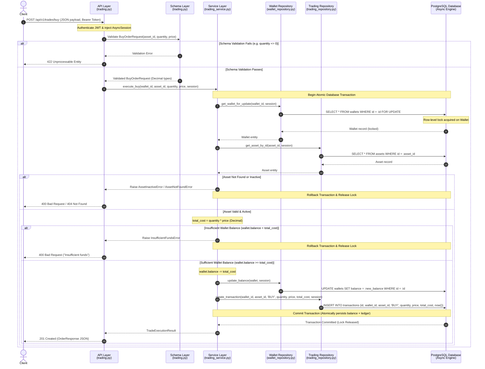
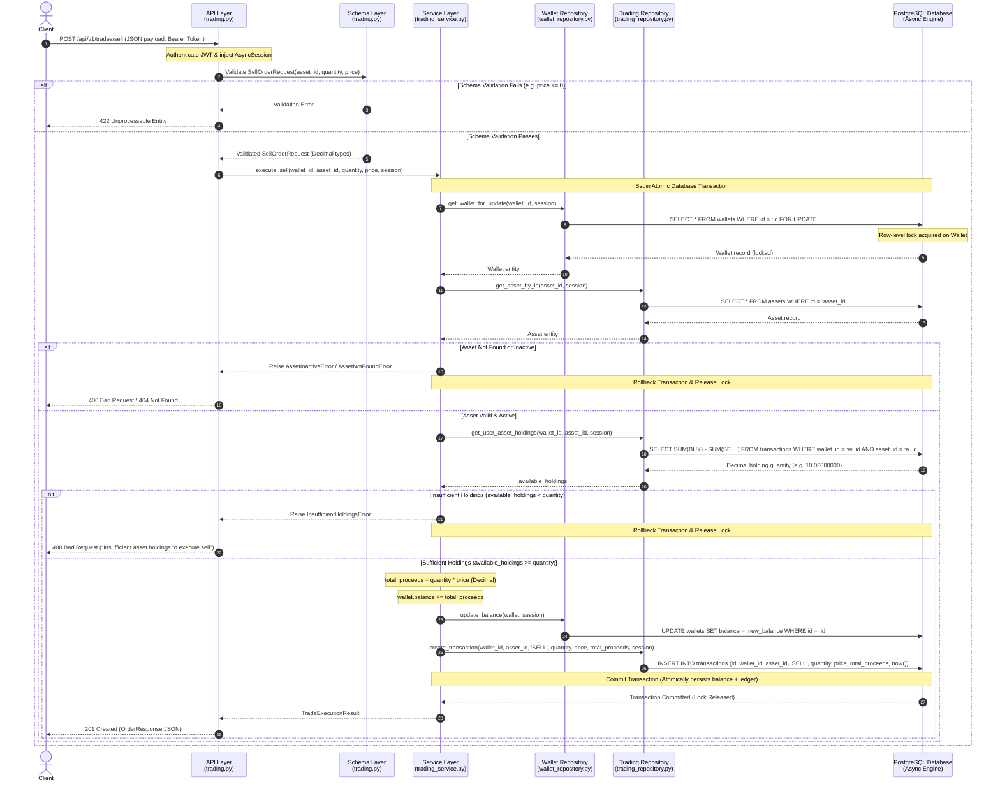

# AlgoTrade Pro – Trading Engine Architectural Design & Integration Plan

**Component:** Trading Engine, Transaction Integrity, Concurrency, and Portfolio Aggregation
**Feature Branch:** `feature/trading-engine`
**Base Branch:** `main`
**Author:** Team Lead – Trading Engine
**Status:** Approved Architecture Baseline

---

## 1. System Overview & Context

AlgoTrade Pro is an educational algorithmic trading simulator backend designed around asynchronous FastAPI, SQLAlchemy 2.0 (asyncio), PostgreSQL, and Pydantic v2.

The core responsibility of the **Trading Engine** is to:
1. Provide deterministic, atomic execution of simulated **BUY** and **SELL** orders.
2. Guarantee immutable transaction recording in the append-only ledger (`transactions` table).
3. Protect wallet balances and portfolio holdings from race conditions using pessimistic row-level locking (`SELECT FOR UPDATE`).
4. Prevent negative balances and phantom executions at both application and database levels.
5. Compute portfolio holdings and user transaction history accurately with exact `Decimal` precision.

---

## 2. Existing Repository Architecture Analysis

### 2.1 Database Models & Schema Baseline

The existing models define the foundational entities:

```
+--------------------+            +--------------------+
|       User         | 1        1 |       Wallet       |
|--------------------|------------|--------------------|
| id: UUID (PK)      |            | id: UUID (PK)      |
| email: str(255)    |            | user_id: UUID (FK) |
| password_hash: str |            | balance: Num(20,8) |
| created_at / upd   |            | currency: str(3)   |
+--------------------+            +--------------------+
                                            | 1
                                            |
                                            | *
+--------------------+            +--------------------+
|       Asset        | 1        * |    Transaction     |
|--------------------|------------|--------------------|
| id: UUID (PK)      |            | id: UUID (PK)      |
| symbol: str(20)    |            | wallet_id: UUID(FK)|
| name: str(150)     |            | asset_id: UUID(FK) |
| asset_type: str(30)|            | transaction_type   |
| currency: str(3)   |            | quantity: Num(24,8)|
| is_active: bool    |            | price: Num(24,8)   |
| created_at / upd   |            | total_amt: Num(28,8|
+--------------------+            | created_at (only)  |
                                  +--------------------+
```

### 2.2 Key Constraints Present in the Database

1. **Wallets (`wallets` table):**
   - `ck_wallets_balance_non_negative`: `balance >= 0` (PostgreSQL CHECK constraint prevents negative balance at DB level).
   - `uq_wallets_user_id`: 1:1 relationship between User and Wallet.
   - Foreign key to `users.id` with `ondelete="RESTRICT"`.

2. **Transactions (`transactions` table - Immutable Ledger):**
   - `ck_transactions_valid_transaction_type`: `transaction_type IN ('BUY', 'SELL')`.
   - `ck_transactions_quantity_positive`: `quantity > 0`.
   - `ck_transactions_price_positive`: `price > 0`.
   - `ck_transactions_total_amount_positive`: `total_amount > 0`.
   - `ck_transactions_total_amount_matches_quantity_price`: `total_amount = quantity * price`.
   - Foreign keys to `wallets.id` and `assets.id` with `ondelete="RESTRICT"`.
   - Append-only design: Inherits from `Base` with `created_at` only; no `updated_at`.

3. **Assets (`assets` table):**
   - `symbol`: Unique index (`ix_assets_symbol`), max 20 chars.
   - `is_active`: Boolean flag controlling tradability.

---

## 3. Layer-by-Layer Architectural Responsibilities

The Trading Engine adheres to a strict layered architecture with clean separation of concerns, unidirectional dependencies, and explicit boundaries:

```
[ HTTP Client / Frontend ]
          │
          ▼
┌────────────────────────────────────────────────────────┐
│ 1. API Layer (src/api/)                                │
│    - Endpoints, Routing, Status Codes                  │
│    - Dependency Injection (get_db, Auth)               │
│    - HTTP Exception Translation                        │
└───────────────────────┬────────────────────────────────┘
                        │ Validated Schemas
                        ▼
┌────────────────────────────────────────────────────────┐
│ 2. Schema Layer (src/schemas/)                         │
│    - Pydantic v2 Request & Response Models             │
│    - Exact Decimal Parsing & Quantization              │
│    - Field Validation (>0, scale <= 8)                 │
└───────────────────────┬────────────────────────────────┘
                        │ Typed Parameters / Payloads
                        ▼
┌────────────────────────────────────────────────────────┐
│ 3. Service Layer (src/services/)                       │
│    - Core Business Logic & Orchestration               │
│    - Atomic Transaction Boundary (session.begin())     │
│    - Pre-condition Checks (Funds, Holdings, Active)    │
│    - Concurrency Coordination via Row Locks            │
└───────────────────────┬────────────────────────────────┘
                        │ ORM Entities & Queries
                        ▼
┌────────────────────────────────────────────────────────┐
│ 4. Repository Layer (src/repositories/)                │
│    - SQLAlchemy 2.0 Async Query Construction           │
│    - Row Locking: SELECT ... FOR UPDATE                │
│    - Ledger Insertions & Historical Aggregations       │
└───────────────────────┬────────────────────────────────┘
                        │ AsyncPG Sockets
                        ▼
┌────────────────────────────────────────────────────────┐
│ 5. Database Layer (src/models/ & src/core/database.py) │
│    - PostgreSQL Database Engine & Connection Pool      │
│    - Declarative ORM Models & Table Schemas            │
│    - Check Constraints & Relational Integrity          │
└────────────────────────────────────────────────────────┘
```

### 3.1 API Layer (`src/api/` / `src/api/v1/trading.py`)
- **Primary Responsibility:** Exposing RESTful HTTP endpoints for trading operations and serving as the external interface of the backend.
- **Specific Duties:**
  - Route definitions: `POST /api/v1/trades/buy`, `POST /api/v1/trades/sell`, `GET /api/v1/trades/history`.
  - Resolving dependencies: Injecting the async database session via `Depends(get_db)` and obtaining authenticated user identity / wallet context via JWT security dependencies.
  - Request deserialization and input binding to Pydantic v2 schemas.
  - HTTP status code mapping: Returning `201 Created` for successful trades, `200 OK` for history queries, `400 Bad Request` for business rule violations (insufficient funds, insufficient holdings, inactive asset), `404 Not Found` for missing resources, and `422 Unprocessable Entity` for schema validation failures.
  - Exception translation: Catching domain-specific exceptions raised by the service layer (e.g., `InsufficientFundsError`, `InsufficientHoldingsError`, `AssetInactiveError`, `AssetNotFoundError`, `WalletNotFoundError`) and converting them into structured RFC 7807 problem details or clean JSON error responses.
- **Strict Boundary:** The API layer contains **zero** direct database queries and **zero** trade execution logic. It delegates all operational decisions directly to the Service Layer.

### 3.2 Schema Layer (`src/schemas/` / `src/schemas/trading.py`)
- **Primary Responsibility:** Enforcing contract validation, data serialization, and financial precision formatting for all incoming requests and outgoing responses.
- **Specific Duties:**
  - Defining Pydantic v2 schemas: `BuyOrderRequest`, `SellOrderRequest`, `OrderResponse`, `TransactionDetailResponse`, and `TradeType` enum (`BUY`, `SELL`).
  - Strict type enforcement: Ensuring all monetary and quantitative amounts (`quantity`, `price`, `total_amount`) use Python's `Decimal` type. Floating-point numbers are strictly prohibited to prevent loss of precision.
  - Field-level validation:
    - `quantity`: Must be strictly greater than zero (`gt=0`), with a maximum scale of 8 decimal places.
    - `price`: Must be strictly greater than zero (`gt=0`), with a maximum scale of 8 decimal places.
    - `asset_id`: Must be a valid UUID.
  - String sanitization: Trimming leading/trailing whitespace and standardizing symbols where applicable.
  - Serialization: Formatting timestamp fields (`created_at`) as ISO 8601 strings and serializing `Decimal` values cleanly for client consumption.
- **Strict Boundary:** Schemas do not communicate with the database or execute business rules; they validate shape, types, and mathematical invariants of inputs before service execution.

### 3.3 Service Layer (`src/services/` / `src/services/trading_service.py`)
- **Primary Responsibility:** Orchestrating the core trading business logic, defining database transaction boundaries, and guaranteeing ACID transactional integrity.
- **Specific Duties:**
  - **Transaction Boundary Management:** Wrapping each order execution within an atomic database transaction context (`async with session.begin():`). If any check fails or an unexpected exception occurs, the transaction automatically rolls back, leaving no orphaned state.
  - **Concurrency Coordination:** Requesting pessimistic row-level locking from the repository layer (`get_wallet_for_update`) to serialize concurrent trades targeting the same wallet.
  - **Pre-trade Business Validations:**
    - Verifying the targeted asset exists and is tradable (`is_active == True`).
    - Computing the exact transaction cost/proceeds using `Decimal`: `total_amount = quantity * price`.
    - **For Buy Operations:** Checking `wallet.balance >= total_amount`. If balance is insufficient, raising `InsufficientFundsError`.
    - **For Sell Operations:** Querying user's net holdings for the asset from the ledger (`total_bought - total_sold`) and checking `available_holdings >= quantity`. If holdings are insufficient, raising `InsufficientHoldingsError`.
  - **State Mutation:** Orchestrating the wallet balance update (`wallet.balance -= total_cost` for buy; `wallet.balance += total_proceeds` for sell) and creating the append-only ledger `Transaction` record.
  - **Event / Audit Logging:** Preparing structured execution results to return to the API layer.
- **Strict Boundary:** The Service layer never writes raw SQL or interacts directly with the database driver; it accesses persistence exclusively through the Repository Layer.

### 3.4 Repository Layer (`src/repositories/` / `src/repositories/wallet_repository.py`, `src/repositories/trading_repository.py`)
- **Primary Responsibility:** Isolating all data access logic, executing SQLAlchemy 2.0 async queries, and managing entity persistence.
- **Specific Duties:**
  - **Pessimistic Row Locking:** Implementing `SELECT ... FROM wallets WHERE id = :id FOR UPDATE` via SQLAlchemy's `.with_for_update()` to ensure exclusive row access during balance mutations.
  - **Ledger Ingestion:** Persisting new immutable `Transaction` entities into the `transactions` table.
  - **Holdings Calculation Queries:** Performing ledger aggregation queries to compute net held quantities:
    ```sql
    SELECT COALESCE(SUM(
        CASE
            WHEN transaction_type = 'BUY' THEN quantity
            WHEN transaction_type = 'SELL' THEN -quantity
            ELSE 0
        END
    ), 0)
    FROM transactions
    WHERE wallet_id = :wallet_id AND asset_id = :asset_id;
    ```
  - **Ledger History Queries:** Fetching paginated transaction records filtered by `wallet_id`, `asset_id`, and date ranges, ordered chronologically.
  - **Asset Retrieval:** Querying `Asset` records by ID or symbol.
- **Strict Boundary:** Repositories do not make business rule determinations and **never** commit or rollback transactions independently. They operate strictly within the `AsyncSession` provided by the Service.

### 3.5 Database Layer (SQLAlchemy Models & Async Infrastructure)
- **Primary Responsibility:** Physical data persistence, enforcing relational integrity, executing row locks, and guaranteeing database-level invariants.
- **Specific Duties:**
  - Managing connection pooling via `create_async_engine` and `AsyncSessionLocal` (`expire_on_commit=False`, `autoflush=False`).
  - Enforcing schema-level check constraints:
    - `balance >= 0` on `wallets`.
    - `quantity > 0`, `price > 0`, `total_amount > 0`, `total_amount = quantity * price`, and `transaction_type IN ('BUY', 'SELL')` on `transactions`.
  - Enforcing foreign key constraints with `RESTRICT` on delete to protect transaction ledger auditability.
  - Providing the row-level locking mechanism (`FOR UPDATE`) in PostgreSQL.

---

## 4. Buy Operation Architecture & Sequence Diagram

### 4.1 Step-by-Step Execution Lifecycle

1. **Client Request:** The client sends an authenticated HTTP `POST` request to `/api/v1/trades/buy` with payload `{"asset_id": "<UUID>", "quantity": "10.00000000", "price": "150.25000000"}`.
2. **Authentication & Session Injection:** FastAPI verifies the JWT access token, extracts the user/wallet identity, and invokes `get_db()` to provide an active `AsyncSession`.
3. **Schema Validation:** The request payload is parsed by `BuyOrderRequest`. Pydantic validates that `quantity > 0`, `price > 0`, values are valid `Decimal`, and precision does not exceed 8 decimal places.
4. **Service Dispatch:** The API router invokes `TradingService.execute_buy(wallet_id, asset_id, quantity, price, session)`.
5. **Transaction Initialization:** The service initiates an atomic transaction block: `async with session.begin():`.
6. **Acquire Row-Level Lock:** The service invokes `WalletRepository.get_wallet_for_update(wallet_id, session)`. PostgreSQL executes `SELECT * FROM wallets WHERE id = :id FOR UPDATE`, blocking any concurrent transactions attempting to modify this wallet.
7. **Asset Validation:** The service queries the asset via `TradingRepository.get_asset_by_id(asset_id, session)`. If the asset does not exist, `AssetNotFoundError` is raised; if `asset.is_active` is `False`, `AssetInactiveError` is raised.
8. **Cost Calculation:** The service computes `total_cost = quantity * price` using exact `Decimal` arithmetic.
9. **Balance Verification:**
   - **Case A (Insufficient Funds):** If `wallet.balance < total_cost`, the service raises `InsufficientFundsError`. The transaction context exits, triggering an automatic `ROLLBACK`. The API layer catches the error and returns HTTP `400 Bad Request`.
   - **Case B (Sufficient Funds):** If `wallet.balance >= total_cost`, execution proceeds.
10. **Balance Deduction:** The service decrements the wallet's balance: `wallet.balance -= total_cost` via `WalletRepository.update_balance()`.
11. **Ledger Record Creation:** The service instantiates a new `Transaction` entity (`transaction_type="BUY"`, `quantity=quantity`, `price=price`, `total_amount=total_cost`) and saves it via `TradingRepository.create_transaction()`.
12. **Transaction Commit:** The `session.begin()` block completes successfully, committing the balance deduction and ledger record simultaneously. The PostgreSQL row lock is released.
13. **Response Serialization:** The service returns a domain trade result, which the API router serializes into `OrderResponse` and returns to the client with HTTP `201 Created`.

### 4.2 Buy Operation Sequence Diagram



---

## 5. Sell Operation Architecture & Sequence Diagram

### 5.1 Step-by-Step Execution Lifecycle

1. **Client Request:** The client sends an authenticated HTTP `POST` request to `/api/v1/trades/sell` with payload `{"asset_id": "<UUID>", "quantity": "5.00000000", "price": "155.00000000"}`.
2. **Authentication & Session Injection:** FastAPI authenticates the user, extracts the wallet context, and provides the async database session.
3. **Schema Validation:** The payload is validated by `SellOrderRequest` ensuring `quantity > 0`, `price > 0`, and strict `Decimal` representation.
4. **Service Dispatch:** The API router calls `TradingService.execute_sell(wallet_id, asset_id, quantity, price, session)`.
5. **Transaction Initialization:** The service opens an atomic transaction block: `async with session.begin():`.
6. **Acquire Row-Level Lock:** The service locks the wallet via `WalletRepository.get_wallet_for_update(wallet_id, session)` (`SELECT ... FOR UPDATE`), serializing any other simultaneous trades for this wallet.
7. **Asset Validation:** The service confirms the asset exists and is active (`is_active == True`).
8. **Holdings Verification:**
   - The service queries net asset holdings via `TradingRepository.get_user_asset_holdings(wallet_id, asset_id, session)`.
   - The repository executes a SQL aggregation summing all prior `BUY` quantities and subtracting all prior `SELL` quantities for that specific wallet and asset.
   - **Case A (Insufficient Holdings):** If `available_holdings < quantity`, the user is attempting to sell assets they do not own. The service raises `InsufficientHoldingsError`. The transaction rolls back, releasing the lock, and the API returns HTTP `400 Bad Request`.
   - **Case B (Sufficient Holdings):** If `available_holdings >= quantity`, execution proceeds.
9. **Proceeds Calculation:** The service computes `total_proceeds = quantity * price` using exact `Decimal` arithmetic.
10. **Balance Credit:** The service increments the wallet balance: `wallet.balance += total_proceeds` via `WalletRepository.update_balance()`.
11. **Ledger Record Creation:** The service creates an immutable `Transaction` record (`transaction_type="SELL"`, `quantity=quantity`, `price=price`, `total_amount=total_proceeds`) and inserts it via `TradingRepository.create_transaction()`.
12. **Transaction Commit:** The database transaction commits atomically. Both the credit to the wallet balance and the append-only sell transaction are permanently written. The row lock is released.
13. **Response Serialization:** The router serializes the result into `OrderResponse` and returns HTTP `201 Created` to the client.

### 5.2 Sell Operation Sequence Diagram



---

## 6. Request & Response Lifecycle Across Architectural Boundaries

The table below illustrates how a trading request transforms as it travels across each layer boundary, and how data types are mapped between layers:

| Boundary | Inbound Data Structure | Responsibility at Boundary | Outbound Data Structure |
|---|---|---|---|
| **Client ➔ API Layer** | HTTP Request (Raw JSON string + Authorization Header) | FastAPI extracts path/body, verifies Bearer token, initiates DB session dependency (`get_db`). | Raw dictionary payload |
| **API Layer ➔ Schema Layer** | Raw dictionary payload | Pydantic v2 model parses strings into `UUID` and `Decimal`. Validates `gt=0`, scale `<= 8`. | Validated `BuyOrderRequest` / `SellOrderRequest` |
| **API Layer ➔ Service Layer** | Validated Pydantic schema + `AsyncSession` + `wallet_id` | Router calls `TradingService` method. Service begins transaction context (`session.begin()`). | Typed parameters (`UUID`, `Decimal`, `AsyncSession`) |
| **Service Layer ➔ Repository Layer** | Entity identifiers (`wallet_id`, `asset_id`), `Decimal` quantities | Service issues query commands. Repository builds SQLAlchemy 2.0 async `select()` / `insert()` statements with `.with_for_update()`. | SQLAlchemy executable statements |
| **Repository Layer ➔ Database** | Compiled SQL statements via AsyncPG driver | PostgreSQL acquires row locks, checks constraints, commits changes or rolls back. | Raw database row tuples / lock acknowledgements |
| **Database ➔ Repository Layer** | Raw PostgreSQL tuples | AsyncPG maps rows to SQLAlchemy ORM model instances (`Wallet`, `Asset`, `Transaction`). | ORM instances (`Wallet`, `Transaction`) |
| **Repository Layer ➔ Service Layer** | ORM model instances / scalar Decimal aggregations | Service evaluates business conditions, modifies entity attributes, and triggers commit. | Domain result entity / execution metadata |
| **Service Layer ➔ API Layer** | Domain trade result entity | Service returns successfully. Router converts result into schema response. Handles domain exceptions. | `OrderResponse` Pydantic model |
| **API Layer ➔ Client** | `OrderResponse` Pydantic model | FastAPI serializes model to JSON and attaches HTTP status code (`201 Created`). | HTTP Response (JSON payload + status 201) |

---

## 7. Database Locking & Transaction Concurrency Strategy

This section provides the comprehensive database locking, transaction boundary, and concurrency control architecture for safe, deterministic concurrent trading.

### 7.1 Wallet Row-Level Locking (`SELECT FOR UPDATE`)

#### 7.1.1 Why Simultaneous Requests Cause Race Conditions (Lost Updates & Double-Spending)
In an asynchronous, multi-worker backend, two or more trade requests for the same wallet can arrive at nearly identical timestamps:
- **Scenario:** A user has a wallet balance of **$100.00**.
- **Concurrent Requests:** Request $A$ (Buy $80.00) and Request $B$ (Buy $80.00) execute simultaneously.
- **Race Condition without Locking:**
  1. Connection $A$ reads `balance = $100.00`. Checks $100 \ge 80$ (Pass).
  2. Connection $B$ reads `balance = $100.00` before Connection $A$ commits. Checks $100 \ge 80$ (Pass).
  3. Connection $A$ sets `balance = $100 - $80 = $20.00` and commits.
  4. Connection $B$ sets `balance = $100 - $80 = $20.00` (or $20 - 80 = -$60.00$) and commits.
  - **Outcome:** Either a **lost update** occurs (user spent $160 but balance is $20), or an integrity check failure (`ck_wallets_balance_non_negative`) crashes the request abruptly without graceful domain handling.

#### 7.1.2 Why PostgreSQL Pessimistic Row-Level Locking is Appropriate
1. **Row-Granularity:** `SELECT ... FOR UPDATE` acquires an exclusive lock strictly on the targeted `wallets` row. Trades executed by User X do not lock or delay trades executed by User Y.
2. **Deterministic Serialization:** Concurrent trade requests for the *same* wallet are queued sequentially by PostgreSQL's lock manager, eliminating race conditions before data evaluation begins.
3. **Avoidance of Optimistic Retry Churn:** In high-frequency algorithmic trading, optimistic concurrency control (version numbers) results in high abort rates under load. Pessimistic locking guarantees that waiting requests succeed in sequence if sufficient balance/holdings remain, without requiring application-level retry loops.
4. **PostgreSQL Read Committed Semantics:** In PostgreSQL's default `READ COMMITTED` isolation level, when a blocked `SELECT ... FOR UPDATE` query finally acquires the lock after the holding transaction commits, **it automatically re-evaluates the query using the newly committed row state**. This ensures the waiting transaction immediately sees the updated balance.

#### 7.1.3 SQLAlchemy 2.0 Implementation Pattern
In SQLAlchemy 2.0 async, row-level locking is requested using the `.with_for_update()` clause:

```python
# Illustrative repository pattern (src/repositories/wallet_repository.py)
from sqlalchemy import select
from sqlalchemy.ext.asyncio import AsyncSession
from src.models.wallet import Wallet

class WalletRepository:
    @staticmethod
    async def get_wallet_for_update(wallet_id: uuid.UUID, session: AsyncSession) -> Wallet | None:
        """
        Acquire an exclusive row-level lock on the specified wallet row.
        Executes: SELECT * FROM wallets WHERE id = :wallet_id FOR UPDATE
        """
        stmt = (
            select(Wallet)
            .where(Wallet.id == wallet_id)
            .with_for_update()
        )
        result = await session.execute(stmt)
        return result.scalar_one_or_none()
```

#### 7.1.4 Lock Lifecycle (Acquisition & Release)
- **Lock Acquisition:** The row lock is acquired when PostgreSQL executes the `SELECT ... FOR UPDATE` query via `await session.execute(stmt)` inside an active transaction.
- **Lock Hold Duration:** The lock is held exclusively by that database connection for the lifetime of the transaction.
- **Lock Release:** The lock is automatically released by PostgreSQL when the transaction finishes—either via `COMMIT` (successful completion) or `ROLLBACK` (error/exception).

#### 7.1.5 Handling Missing Wallet Records
If `result.scalar_one_or_none()` evaluates to `None`:
1. The service immediately raises a domain exception: `WalletNotFoundError(wallet_id)`.
2. The active transaction context exits cleanly, triggering an immediate `ROLLBACK`.
3. The API layer maps `WalletNotFoundError` to HTTP `404 Not Found` with a descriptive error payload.

---

### 7.2 Transaction Atomicity & Service Boundary

#### 7.2.1 Service-Owned Transaction Boundary & SQLAlchemy Autobegin Protection
The Service layer strictly owns the lifecycle of the database transaction. Every trade operation executes within a single async context manager:

##### Understanding SQLAlchemy 2.0 Autobegin
SQLAlchemy 2.0 `AsyncSession` uses an **autobegin** model by default. When any query (such as a read or execute) is executed on an idle session without an explicit `session.begin()`, SQLAlchemy automatically initiates an implicit transaction.
- **Risk:** If an earlier middleware, pre-execution hook, or dependency executes a database query on the session *before* reaching the service layer's `async with session.begin():`, SQLAlchemy raises:
  `sqlalchemy.exc.InvalidRequestError: A transaction is already begun on this Session.`
- **Architectural Safeguards:**
  1. **Clean Dependency Hand-Off:** FastAPI's `get_db()` yields a pristine session that has not executed any statements. No middleware or authentication dependency may execute queries on the trading session prior to `TradingService`.
  2. **Service Entry Point:** The service layer enters `async with session.begin():` as the **very first operation** touching the database on that session.
  3. **Idempotent Boundary Pattern:** Where ambient transactions may exist (e.g., in integration tests), the service checks `if not session.in_transaction():` or utilizes `session.begin_nested()` to create a savepoint rather than attempting a duplicate top-level begin.

```python
# Conceptual Service Layer Transaction Boundary (src/services/trading_service.py)
class TradingService:
    async def execute_buy(
        self,
        wallet_id: uuid.UUID,
        asset_id: uuid.UUID,
        quantity: Decimal,
        price: Decimal,
        session: AsyncSession,
    ) -> OrderResponse:
        # Atomic Transaction Boundary begins here before any query executes:
        async with session.begin():
            # 1. Acquire pessimistic lock on wallet
            wallet = await self.wallet_repo.get_wallet_for_update(wallet_id, session)
            if wallet is None:
                raise WalletNotFoundError(wallet_id)

            # 2. Validate asset tradability
            asset = await self.trading_repo.get_asset_by_id(asset_id, session)
            if asset is None:
                raise AssetNotFoundError(asset_id)
            if not asset.is_active:
                raise AssetInactiveError(asset.symbol)

            # 3. Calculate exact cost and verify balance
            total_cost = quantity * price
            if wallet.balance < total_cost:
                raise InsufficientFundsError(available=wallet.balance, required=total_cost)

            # 4. Mutate wallet balance
            wallet.balance -= total_cost

            # 5. Persist immutable transaction ledger record
            transaction = Transaction(
                wallet_id=wallet.id,
                asset_id=asset.id,
                transaction_type="BUY",
                quantity=quantity,
                price=price,
                total_amount=total_cost,
            )
            await self.trading_repo.create_transaction(transaction, session)

        # Transaction COMMITS automatically when exiting the block without exceptions.
        # If any exception was raised, transaction ROLLS BACK automatically.
        return self._build_order_response(transaction)
```

#### 7.2.2 All-or-Nothing Operations
The following database modifications **must succeed or fail as a single atomic unit**:
1. **Wallet Balance Deduction or Credit:** Updating `wallets.balance`.
2. **Transaction Ledger Insertion:** Inserting the immutable record into `transactions`.
3. **Database Constraint Validations:** Ensuring `ck_wallets_balance_non_negative` and `ck_transactions_total_amount_matches_quantity_price` hold true.

*Failure Consequence:* If balance deduction succeeded without ledger insertion, user funds would disappear without an audit trail. If ledger insertion succeeded without balance deduction, free trades would occur. The atomic transaction boundary guarantees this split-state anomaly is physically impossible.

#### 7.2.3 Repository Non-Commit Rule
- **Rule:** Repositories (`WalletRepository`, `TradingRepository`) **must never** call `session.commit()` or `session.rollback()`.
- **Reason:** Repositories are purely data access providers. An atomic business operation spans multiple repository calls (locking wallet, reading asset, aggregating holdings, updating balance, inserting ledger entry). If a repository committed prematurely, partial updates would be permanently written to the database before subsequent validation steps execute, destroying ACID transaction guarantees.

---

### 7.3 Concurrency Scenarios & Execution Analysis

#### 7.3.1 Scenario 1: Two Simultaneous Buy Requests on One Wallet
- **Initial State:** `Wallet.balance = $100.00`.
- **Requests:** Trade 1 (Buy $70.00), Trade 2 (Buy $60.00) arrive concurrently.
- **Execution Flow:**
  1. Trade 1 enters `session.begin()` and issues `SELECT ... FROM wallets WHERE id = :id FOR UPDATE`. Lock is granted to Trade 1.
  2. Trade 2 enters `session.begin()` and issues `SELECT ... FROM wallets WHERE id = :id FOR UPDATE`. PostgreSQL detects existing exclusive lock and puts Trade 2 into `LockWait` state.
  3. Trade 1 evaluates: `balance ($100.00) >= cost ($70.00)` ➔ **Valid**.
  4. Trade 1 sets `balance = $30.00`, inserts `BUY` transaction record, and exits `session.begin()`.
  5. Trade 1 **COMMITS**. Lock is released.
  6. PostgreSQL awakens Trade 2 and returns the wallet row. Under PostgreSQL `READ COMMITTED`, `FOR UPDATE` returns the **newly committed row version**: `balance = $30.00`.
  7. Trade 2 evaluates: `balance ($30.00) >= cost ($60.00)` ➔ **Insufficient Funds**.
  8. Trade 2 raises `InsufficientFundsError`. Transaction block exits, triggering **ROLLBACK**.
  - **Result:** Trade 1 succeeds (balance $30.00); Trade 2 is cleanly rejected with HTTP 400. Zero race conditions, zero negative balance.

#### 7.3.2 Scenario 2: Two Simultaneous Sell Requests on One Wallet
- **Initial State:** User holds **10 units** of AAPL; `Wallet.balance = $50.00`.
- **Requests:** Trade 1 (Sell 7 AAPL @ $10.00), Trade 2 (Sell 6 AAPL @ $10.00) arrive concurrently.
- **Execution Flow:**
  1. Trade 1 acquires row lock on `Wallet`. Trade 2 requests row lock and enters `LockWait`.
  2. Trade 1 calculates available holdings from ledger: `SUM(BUY) - SUM(SELL) = 10 units`.
  3. Trade 1 evaluates: `holdings (10) >= quantity (7)` ➔ **Valid**.
  4. Trade 1 updates balance: `balance = $50.00 + $70.00 = $120.00`.
  5. Trade 1 inserts `SELL` record (7 units).
  6. Trade 1 **COMMITS**. Ledger and balance are persisted; lock is released.
  7. Trade 2 awakens with exclusive lock.
  8. Trade 2 calculates available holdings from ledger: `SUM(BUY) - SUM(SELL) = 10 - 7 = 3 units`.
  9. Trade 2 evaluates: `holdings (3) < quantity (6)` ➔ **Insufficient Holdings**.
  10. Trade 2 raises `InsufficientHoldingsError`. Transaction **ROLLS BACK**.
  - **Result:** Trade 1 completes (balance $120.00, 3 units remaining); Trade 2 is cleanly rejected with HTTP 400. Zero overselling, zero phantom holdings.

#### 7.3.3 Scenario 3: Interleaved Buy and Sell Requests on One Wallet
- **Initial State:** `Wallet.balance = $10.00`, user holds 5 AAPL.
- **Requests:** Trade 1 (Sell 5 AAPL @ $100 = +$500), Trade 2 (Buy 1 TSLA @ $200 = -$200).
- **Execution Flow:**
  - If Trade 1 locks first: Wallet balance becomes $510.00. Trade 2 acquires lock next, sees $510.00 >= $200, balance becomes $310.00. Both succeed sequentially.
  - If Trade 2 locks first: Trade 2 sees balance $10.00 < $200, fails with `InsufficientFundsError`, rolls back. Trade 1 acquires lock next, executes sell, balance becomes $510.00.
  - **Result:** In both interleavings, state transitions are strictly linear, mathematically consistent, and deterministic.

#### 7.3.4 What Happens When a Wallet is Locked (LockWait & Driver/SQLSTATE Timeouts)
- When a connection requests `FOR UPDATE` on a locked row, PostgreSQL pauses query execution on that socket and registers the connection in its internal lock wait graph.
- The waiting connection consumes negligible CPU while waiting on the socket.
- To prevent indefinite hangs in the event of an orphaned client connection or degraded external network, the application will configure a PostgreSQL statement-level lock timeout:
  ```sql
  SET LOCAL lock_timeout = '5s';
  ```
  If a lock cannot be acquired within 5 seconds, PostgreSQL aborts the query with SQLSTATE code `55P03` (`lock_not_available`).
- **Driver and SQLSTATE Classification:**
  Depending on the async driver and SQLAlchemy version:
  - AsyncPG may raise `asyncpg.exceptions.LockNotAvailableError` or wrap it within `QueryCanceledError` / `PostgresError` with `sqlstate='55P03'`.
  - SQLAlchemy catches and wraps this driver exception inside `sqlalchemy.exc.OperationalError` or `sqlalchemy.exc.DBAPIError`.
  - **Classification Protocol:** The exception handling layer must inspect `getattr(exc.orig, 'pgcode', None) == '55P03'` (or driver SQLSTATE attributes) rather than relying on a single Python exception class. This reliably triggers an immediate clean rollback and an HTTP `503 Service Unavailable` response with `LOCK_TIMEOUT`.

#### 7.3.5 Revalidation Invariant: Why Balance and Holdings Must Be Evaluated INSIDE the Lock
- **Critical Architectural Invariant:** Reading wallet balance or calculating holdings *before* acquiring the row lock is a severe defect.
- Outside the lock, any read reflects a point-in-time snapshot that could be invalidated a millisecond later by a concurrent commit.
- By acquiring `SELECT ... FOR UPDATE` **first**, all subsequent balance reads and ledger aggregation queries within the transaction are guaranteed to observe the most recent committed state and cannot be mutated by another transaction until the lock is released.

#### 7.3.6 Additional Locking Requirements for Ledger-Calculated Holdings
*Addressing the multi-ledger concurrency boundary:*
- While the `Wallet` row lock serializes all trade operations initiated by that user (because all user trades require `wallets.id`), we **must not** assume wallet locking alone covers every edge case:
  1. **Non-Trading Ledger Mutations:** If future background services (e.g., dividend distributions, automated recurring deposits, administrative portfolio corrections, corporate actions) insert rows directly into `transactions` without acquiring `FOR UPDATE` on `wallets`, a concurrent Sell operation could experience a phantom read or calculate an inaccurate holding balance.
     - **Architectural Mandate:** *Every operational path in the system that inserts or modifies `Transaction` records MUST acquire the row-level lock on `wallets` first.* The `Wallet` row serves as the centralized root synchronization mutex for that user's entire financial state.
  2. **Holdings Aggregation Isolation:** The query calculating net holdings (`SUM(BUY) - SUM(SELL)`) must execute **inside the same transaction** and **after** the `Wallet` lock has been established. This guarantees that no other transaction can commit new trades for that wallet between the holding calculation and the sell execution.
  3. **Deterministic Deadlock Prevention:** If future features introduce operations involving multiple wallets (e.g., peer-to-peer asset transfers), locks must always be acquired in a deterministic order (e.g., sorted ascending by `wallet_id`: `min(w1, w2)` followed by `max(w1, w2)`). This eliminates cyclic ABBA wait conditions.

---

## 8. Complete Trading Engine Error-Handling Matrix & Protocol

This section formalizes the error-handling matrix, domain exception hierarchy, layer responsibilities, rollback behaviors, and client error response structures across all trading execution paths.

### 8.1 The 12 Core Trading Engine Error Scenarios

| # | Error Scenario | Responsible Layer | Triggering Condition | Proposed Domain / System Exception | HTTP Status Code | Machine-Readable Error Code | Client-Facing Safe Error Message | Transaction Rollback? |
|:---:|---|---|---|---|:---:|---|---|:---:|
| **1** | **Insufficient Wallet Balance** | **Service Layer** | `wallet.balance < (quantity * price)` during Buy execution | `InsufficientFundsError` | `400 Bad Request` | `INSUFFICIENT_FUNDS` | `"Insufficient wallet balance to execute this buy order."` | **Yes** (Automatic via `session.begin()`) |
| **2** | **Inactive Asset** | **Service Layer** | `asset.is_active is False` | `AssetInactiveError` | `400 Bad Request` | `ASSET_INACTIVE` | `"The requested asset is currently inactive and cannot be traded."` | **Yes** (Automatic via `session.begin()`) |
| **3** | **Asset Not Found** | **Service Layer** | Query for `asset_id` returns `None` | `AssetNotFoundError` | `404 Not Found` | `ASSET_NOT_FOUND` | `"The specified tradable asset does not exist."` | **Yes** (Automatic via `session.begin()`) |
| **4** | **Invalid or Non-Positive Quantity** | **Schema Layer** | `quantity <= 0`, `NaN`, scale > 8, or unparseable | `pydantic.ValidationError` | `422 Unprocessable Entity` | `INVALID_QUANTITY` | `"Quantity must be a positive decimal number with at most 8 decimal places."` | **No** (Pre-transaction, rejected before DB access) |
| **5** | **Invalid or Non-Positive Price** | **Schema Layer** | `price <= 0`, `NaN`, scale > 8, or unparseable | `pydantic.ValidationError` | `422 Unprocessable Entity` | `INVALID_PRICE` | `"Price must be a positive decimal number with at most 8 decimal places."` | **No** (Pre-transaction, rejected before DB access) |
| **6** | **Wallet Not Found** | **Service Layer** | Query for `wallet_id` with `FOR UPDATE` returns `None` | `WalletNotFoundError` | `404 Not Found` | `WALLET_NOT_FOUND` | `"User trading wallet not found."` | **Yes** (Automatic via `session.begin()`) |
| **7** | **Insufficient Holdings During Sell** | **Service Layer** | `available_holdings < quantity` | `InsufficientHoldingsError` | `400 Bad Request` | `INSUFFICIENT_HOLDINGS` | `"Insufficient asset holdings to execute this sell order."` | **Yes** (Automatic via `session.begin()`) |
| **8** | **Database Constraint Violation** | **Database Layer** | Check, foreign key, or unique constraint violated in PostgreSQL | `sqlalchemy.exc.IntegrityError` | Classified by SQLSTATE / Constraint: `400` (balance check), `404` (FK missing), `409` (unique), `422` (math check) | `INTEGRITY_VIOLATION` / `INSUFFICIENT_FUNDS` | Dynamic safe message based on constraint classification | **Yes** (PostgreSQL immediately aborts transaction) |
| **9** | **Database Connection Failure** | **Database Layer** | PostgreSQL unreachable, socket reset, network failure | `sqlalchemy.exc.OperationalError` / `asyncpg.exceptions.PostgresConnectionError` | `503 Service Unavailable` | `DATABASE_CONNECTION_ERROR` | `"Database service temporarily unavailable. Please retry later."` | **Yes** (Socket dropped, PostgreSQL server-aborted) |
| **10** | **Commit / Disconnection Failure** | **Service / Database Layer** | Socket drops or network partition precisely during `COMMIT` phase | `sqlalchemy.exc.OperationalError` / `sqlalchemy.exc.DBAPIError` | `503 Service Unavailable` / `500` | `TRANSACTION_OUTCOME_UNCERTAIN` | `"Network interruption occurred during trade confirmation. Please inspect your order history before retrying."` | **Indeterminate** (Server may have committed before drop; requires status verification, not blind rollback assumption) |
| **11** | **Row-Lock Timeout** | **Database Layer** | Waiting for `FOR UPDATE` lock on `Wallet` exceeds `5s` (`SQLSTATE 55P03`) | `asyncpg.exceptions.PostgresError` (`55P03`) / `sqlalchemy.exc.OperationalError` | `503 Service Unavailable` | `LOCK_TIMEOUT` | `"Trading engine is busy processing other transactions on this wallet. Please retry."` | **Yes** (PostgreSQL query timeout aborts transaction) |
| **12** | **Unauthorized Request** | **API Layer** | Missing, expired, malformed, or invalid JWT Bearer token | `fastapi.HTTPException(status_code=401)` | `401 Unauthorized` | `UNAUTHORIZED` | `"Authentication credentials were not provided or are invalid."` | **No** (Rejected at dependency injection before DB access) |

---

### 8.2 Error-Handling Responsibilities Across Architecture Tiers

```
[ Incoming HTTP Request ]
          │
          ▼
┌────────────────────────────────────────────────────────────────────────┐
│ 1. API Security / Dependency Layer                                     │
│    - Scenario 12: Validate JWT Bearer token                            │
│    - Fails ➔ 401 Unauthorized (No DB connection opened)                │
└─────────────────────────────────┬──────────────────────────────────────┘
                                  │ Valid JWT Context
                                  ▼
┌────────────────────────────────────────────────────────────────────────┐
│ 2. Schema Validation Layer (Pydantic v2)                               │
│    - Scenarios 4 & 5: Check quantity > 0, price > 0, Decimal scale <= 8│
│    - Fails ➔ 422 Unprocessable Entity (Zero DB interaction)            │
└─────────────────────────────────┬──────────────────────────────────────┘
                                  │ Syntactically Valid Payload
                                  ▼
┌────────────────────────────────────────────────────────────────────────┐
│ 3. Service Layer Business Logic (async with session.begin():)          │
│    - Scenario 6: Verify wallet exists (WalletNotFoundError ➔ 404)       │
│    - Scenario 3: Verify asset exists (AssetNotFoundError ➔ 404)        │
│    - Scenario 2: Verify asset active (AssetInactiveError ➔ 400)        │
│    - Scenario 1: Verify balance >= cost (InsufficientFundsError ➔ 400) │
│    - Scenario 7: Verify holdings >= qty (InsufficientHoldingsError ➔ 400│
│    - Fails ➔ Raises domain exception ➔ Automatic Transaction Rollback  │
└─────────────────────────────────┬──────────────────────────────────────┘
                                  │ Business Rules Validated
                                  ▼
┌────────────────────────────────────────────────────────────────────────┐
│ 4. Database Physical Execution (PostgreSQL / AsyncPG)                  │
│    - Scenario 11: Lock timeout exceeded (QueryCanceledError ➔ 503)     │
│    - Scenario 8: Constraint violation (IntegrityError ➔ 422/400)       │
│    - Scenario 9: Connection dropped (OperationalError ➔ 503)           │
│    - Scenario 10: Commit failed (DBAPIError ➔ 500)                     │
│    - Fails ➔ PostgreSQL aborts ➔ Clean Engine Rollback                │
└─────────────────────────────────┬──────────────────────────────────────┘
                                  │
                                  ▼
                       [ Order Execution Succeeded ]
```

#### 8.2.1 Pydantic Validation vs. Business Validation
A fundamental architectural distinction is maintained between **syntactic/structural validation** and **semantic/business validation**:
1. **Pydantic Validation (Fast-Path Rejection):**
   - Executed automatically by FastAPI during request body parsing *before* any database connection is acquired or any lock is requested.
   - Verifies input types, field presence, positive numerical bounds (`gt=0`), and mathematical limits (e.g. scale $\le 8$).
   - Returns HTTP `422 Unprocessable Entity` immediately. Zero database resources or worker threads are tied up.
2. **Business Validation (State-Dependent Evaluation):**
   - Executed within the Service Layer *after* establishing the atomic transaction context and acquiring the row-level lock on the `Wallet`.
   - Evaluates dynamic database state: Does the user have enough money? Does the user own enough shares? Is the asset currently open for trading?
   - Returns HTTP `400 Bad Request` or `404 Not Found`.

#### 8.2.2 Service-Layer Domain Exceptions
The Trading Engine defines clean, typed domain exceptions that convey explicit business semantics rather than generic HTTP or database errors:

```python
# Illustrative Domain Exception Hierarchy (src/core/exceptions.py or src/services/exceptions.py)
class TradingEngineException(Exception):
    """Base exception for all trading engine business rule violations."""
    def __init__(self, message: str, error_code: str):
        super().__init__(message)
        self.message = message
        self.error_code = error_code

class InsufficientFundsError(TradingEngineException):
    def __init__(self, available: Decimal, required: Decimal):
        super().__init__(
            message="Insufficient wallet balance to execute this buy order.",
            error_code="INSUFFICIENT_FUNDS",
        )
        self.available = available
        self.required = required

class InsufficientHoldingsError(TradingEngineException):
    def __init__(self, available: Decimal, requested: Decimal):
        super().__init__(
            message="Insufficient asset holdings to execute this sell order.",
            error_code="INSUFFICIENT_HOLDINGS",
        )
        self.available = available
        self.requested = requested

class AssetInactiveError(TradingEngineException):
    def __init__(self, symbol: str):
        super().__init__(
            message=f"Asset {symbol} is inactive and cannot be traded.",
            error_code="ASSET_INACTIVE",
        )
        self.symbol = symbol

class AssetNotFoundError(TradingEngineException):
    def __init__(self, asset_id: uuid.UUID):
        super().__init__(
            message="The specified tradable asset does not exist.",
            error_code="ASSET_NOT_FOUND",
        )
        self.asset_id = asset_id

class WalletNotFoundError(TradingEngineException):
    def __init__(self, wallet_id: uuid.UUID):
        super().__init__(
            message="User trading wallet not found.",
            error_code="WALLET_NOT_FOUND",
        )
        self.wallet_id = wallet_id
```

#### 8.2.3 API-Layer Exception Translation
- **Zero Leakage:** The Service layer raises domain exceptions without knowing or caring about HTTP status codes.
- **FastAPI Exception Handlers:** The API layer provides centralized exception handlers (via `@app.exception_handler`) that catch `TradingEngineException` instances and translate them into a standardized JSON envelope:
  ```json
  {
    "error_code": "INSUFFICIENT_FUNDS",
    "message": "Insufficient wallet balance to execute this buy order.",
    "details": {
      "available": "50.00000000",
      "required": "150.25000000"
    }
  }
  ```

#### 8.2.4 Database Exception Shielding & IntegrityError Classification Protocol
- **Security Invariant (CWE-209 Prevention):** Raw database exceptions (e.g. `sqlalchemy.exc.IntegrityError`, `asyncpg.exceptions.CheckViolationError`, or `OperationalError`) must **never** be leaked directly into client HTTP responses. Exposing PostgreSQL table names (`wallets`, `transactions`), constraint names (`ck_wallets_balance_non_negative`), internal column names, or driver socket addresses gives malicious actors reconnaissance intelligence.
- **IntegrityError Classification Protocol:**
  Rather than applying a blanket HTTP `400` or `422` status code to all `IntegrityError` occurrences, the API exception translation layer must inspect the underlying database error code (`exc.orig.pgcode`) and constraint name:
  1. **SQLSTATE `23514` (`check_violation`):**
     - If constraint is `ck_wallets_balance_non_negative`: The balance was exhausted during concurrent execution ➔ Maps to `INSUFFICIENT_FUNDS` (HTTP `400 Bad Request`).
     - If constraint is `ck_transactions_total_amount_matches_quantity_price` or positive value checks: Mathematical inconsistency or corrupted payload ➔ Maps to `INTEGRITY_VIOLATION` (HTTP `422 Unprocessable Entity`).
  2. **SQLSTATE `23503` (`foreign_key_violation`):**
     - If foreign key refers to `wallets.id`: Target wallet does not exist ➔ Maps to `WALLET_NOT_FOUND` (HTTP `404 Not Found`).
     - If foreign key refers to `assets.id`: Target asset does not exist ➔ Maps to `ASSET_NOT_FOUND` (HTTP `404 Not Found`).
  3. **SQLSTATE `23505` (`unique_violation`):**
     - Resource already exists (e.g., duplicate user wallet or asset symbol collision) ➔ Maps to `CONFLICT` (HTTP `409 Conflict`).
  4. **Unclassified or Internal Integrity Failures:**
     - Logged in full server-side with structured request metadata.
     - Returned to client as a sanitized HTTP `422 Unprocessable Entity` or `500 Internal Server Error` with stable code `INTEGRITY_VIOLATION`.

#### 8.2.5 How Rollback is Guaranteed in `async with session.begin():`
SQLAlchemy's `async with session.begin():` context manager utilizes Python's asynchronous context protocol:
1. Upon entry (`__aenter__`), it issues a `BEGIN` statement against the database connection.
2. If an exception exits the block unhandled (whether a domain exception like `InsufficientFundsError`, a database error like `IntegrityError`, or a system cancellation like `asyncio.CancelledError`), the context manager executes its `__aexit__` handler.
3. The `__aexit__` handler unconditionally calls `await session.rollback()`.
4. PostgreSQL discards all uncommitted modifications (wallet balance adjustments, ledger insertions) and **releases all held row-level locks** on `wallets`.
5. The session safely reverts to a clean state before propagating the exception up to the API exception handler.

#### 8.2.6 Indeterminate Commit Outcomes (Disconnection During Commit)
If a network partition, socket disconnection, or worker crash occurs precisely while transmitting `COMMIT` or while awaiting PostgreSQL's acknowledgment:
- **The Core Dilemma:** The client/application cannot know with certainty whether PostgreSQL processed the commit prior to the disconnection or whether it aborted the transaction.
- **Handling Protocol:**
  1. The application layer must **NOT** assume an automatic rollback occurred.
  2. The application must **NOT** blindly re-execute the trade (which could produce an accidental double-trade).
  3. The error handler returns HTTP `503 Service Unavailable` or `500 Internal Server Error` with machine-readable code `TRANSACTION_OUTCOME_UNCERTAIN` and safe message:
     `"A network interruption occurred during trade confirmation. Please inspect your order history before retrying."`
  4. A high-priority operational log is emitted recording `wallet_id`, `asset_id`, and transaction timestamp for automated or manual ledger reconciliation.

---

## 9. Repository Contracts & Async Session Management Architecture

This section formalizes the repository interface specifications, method contracts, dependency-injected session lifecycle, and testing strategy for the Trading Engine.

> **Design Notice:** The repository and service contracts documented in this section represent the **proposed architectural design** for trading operations. They strictly adhere to SQLAlchemy 2.0 async patterns and project conventions.

### 9.1 TradingRepository Contracts & Method Specifications

The `TradingRepository` encapsulates all direct database interactions, query construction, and locking primitives. It receives an active `AsyncSession` upon instantiation or method invocation and does not manage its own transaction boundaries.

| Method Signature | Purpose | Parameters & Types | Return Type | Async? | Acquires Row Lock? | Modifies DB State? |
|---|---|---|---|:---:|:---:|:---:|
| `get_wallet_for_update(wallet_id)` | Fetches a wallet row with exclusive pessimistic lock | `wallet_id: uuid.UUID` | `Wallet \| None` | **Yes** | **Yes** (`FOR UPDATE`) | No (Read with lock) |
| `get_asset_by_id(asset_id)` | Retrieves asset metadata by UUID | `asset_id: uuid.UUID` | `Asset \| None` | **Yes** | No | No (Read only) |
| `get_asset_by_symbol(symbol)` | Retrieves asset metadata by ticker symbol | `symbol: str` | `Asset \| None` | **Yes** | No | No (Read only) |
| `get_transactions_by_wallet(wallet_id, limit, offset)` | Returns paginated chronological ledger records | `wallet_id: uuid.UUID`, `limit: int = 50`, `offset: int = 0` | `Sequence[Transaction]` | **Yes** | No | No (Read only) |
| `get_buy_quantity(wallet_id, asset_id)` | Calculates total units purchased for an asset | `wallet_id: uuid.UUID`, `asset_id: uuid.UUID` | `Decimal` | **Yes** | No (Guarded by wallet lock) | No (Read aggregate) |
| `get_sell_quantity(wallet_id, asset_id)` | Calculates total units sold for an asset | `wallet_id: uuid.UUID`, `asset_id: uuid.UUID` | `Decimal` | **Yes** | No (Guarded by wallet lock) | No (Read aggregate) |
| `get_net_holdings(wallet_id, asset_id)` | Computes net owned units: `SUM(BUY) - SUM(SELL)` | `wallet_id: uuid.UUID`, `asset_id: uuid.UUID` | `Decimal` | **Yes** | No (Guarded by wallet lock) | No (Read aggregate) |
| `create_transaction(transaction)` | Stages an immutable transaction record into session | `transaction: Transaction` | `Transaction` | **Yes** | No | **Yes** (Staged INSERT) |
| `update_wallet_balance(wallet, new_balance)` | Updates the balance on a locked wallet instance | `wallet: Wallet`, `new_balance: Decimal` | `None` | **Yes** | No (Assumes prior lock) | **Yes** (Staged UPDATE) |
| `flush()` | Flushes pending SQL to active transaction buffer | None | `None` | **Yes** | No | **Yes** (Emits DML to DB) |

#### 9.1.1 Detailed Method Analysis
1. **`get_wallet_for_update(wallet_id: uuid.UUID) -> Wallet | None`**
   - **SQL Emitted:** `SELECT * FROM wallets WHERE id = :wallet_id FOR UPDATE`
   - **Behavior:** Blocks until PostgreSQL grants exclusive row lock. Under `READ COMMITTED`, returns the newly committed row state. Returns `None` if not found.
2. **`get_asset_by_id(asset_id: uuid.UUID) -> Asset | None`**
   - **SQL Emitted:** `SELECT * FROM assets WHERE id = :asset_id`
   - **Behavior:** Standard non-locking read. Cached or indexed lookup on primary key.
3. **`get_asset_by_symbol(symbol: str) -> Asset | None`**
   - **SQL Emitted:** `SELECT * FROM assets WHERE symbol = :symbol`
   - **Behavior:** Indexed lookup on unique symbol index (`ix_assets_symbol`).
4. **`get_transactions_by_wallet(wallet_id: uuid.UUID, limit: int = 50, offset: int = 0) -> Sequence[Transaction]`**
   - **SQL Emitted:** `SELECT * FROM transactions WHERE wallet_id = :wallet_id ORDER BY created_at DESC LIMIT :limit OFFSET :offset`
   - **Behavior:** Supports pagination for transaction ledger history.
5. **`get_buy_quantity(wallet_id: uuid.UUID, asset_id: uuid.UUID) -> Decimal`**
   - **SQL Emitted:** `SELECT COALESCE(SUM(quantity), 0) FROM transactions WHERE wallet_id = :wallet_id AND asset_id = :asset_id AND transaction_type = 'BUY'`
   - **Behavior:** Returns `Decimal` sum. Returns `Decimal("0")` if no buy transactions exist.
6. **`get_sell_quantity(wallet_id: uuid.UUID, asset_id: uuid.UUID) -> Decimal`**
   - **SQL Emitted:** `SELECT COALESCE(SUM(quantity), 0) FROM transactions WHERE wallet_id = :wallet_id AND asset_id = :asset_id AND transaction_type = 'SELL'`
   - **Behavior:** Returns `Decimal` sum. Returns `Decimal("0")` if no sell transactions exist.
7. **`get_net_holdings(wallet_id: uuid.UUID, asset_id: uuid.UUID) -> Decimal`**
   - **SQL Emitted:** Single consolidated query:
     ```sql
     SELECT COALESCE(SUM(
         CASE
             WHEN transaction_type = 'BUY' THEN quantity
             WHEN transaction_type = 'SELL' THEN -quantity
             ELSE 0
         END
     ), 0)
     FROM transactions
     WHERE wallet_id = :wallet_id AND asset_id = :asset_id;
     ```
   - **Behavior:** Computes net position with mathematical precision. Always runs within the active transaction after acquiring the wallet lock.
   - **Primary Contract Preference:** While `get_buy_quantity()` and `get_sell_quantity()` exist as atomic queries for specific ledger audits or analytics, the unified `get_net_holdings()` method is the **preferred primary contract** for trade execution. By performing the aggregation in a single database round-trip, it eliminates duplicated SQL queries, minimizes network latency, and avoids calculating the delta in application memory.
8. **`create_transaction(transaction: Transaction) -> Transaction`**
   - **Behavior:** Adds the `Transaction` entity to the SQLAlchemy session (`session.add(transaction)`). Does NOT issue a commit.
9. **`flush() -> None`**
   - **Behavior:** Invokes `await session.flush()`. Sends staged DML statements to PostgreSQL to evaluate immediate check constraints without closing or committing the transaction.

---

### 9.2 Async Session Lifecycle & Invariant Protection

The async session lifecycle guarantees that exactly **one** database session and **one** physical database connection are utilized throughout a single trade request:

```
[ FastAPI HTTP Request ]
          │
          ▼
1. get_db() dependency yields AsyncSession
   (Bound to connection from pool; autoflush=False, expire_on_commit=False)
          │
          ▼
2. API Router receives session and injects into TradingService
   TradingService(session=session)
          │
          ▼
3. Service opens transaction boundary: async with session.begin():
   Issues BEGIN to PostgreSQL
          │
          ▼
4. TradingRepository executes queries using injected session
   (get_wallet_for_update, get_net_holdings, create_transaction)
          │
          ▼
5. All operations succeed ➔ session.begin() issues COMMIT to PostgreSQL
   (If exception occurs ➔ session.begin() issues ROLLBACK to PostgreSQL)
          │
          ▼
6. API Router returns HTTP response (201 / 400 / 404 / 422)
          │
          ▼
7. get_db() context generator resumes execution
   await session.close() returns connection to pool
```

#### 9.2.1 The Eight Rules of Async Session Management
1. **Single Session Source:** The FastAPI dependency `get_db()` is the sole creator of `AsyncSession` instances for HTTP requests.
2. **Explicit Injection:** The active `AsyncSession` is passed explicitly from the API route handler to the service and repository layers.
3. **Service Transaction Ownership:** The Service Layer exclusively owns the transaction boundary using `async with session.begin():`.
4. **Repository Session Sharing:** All repository methods must accept and operate on the injected session.
5. **No Independent Sessions:** Repositories must never instantiate their own `AsyncSession` or call `AsyncSessionLocal()`.
6. **No Independent Commits:** Repositories must never call `session.commit()` or `session.rollback()`.
7. **Unimpeded Exception Flow:** Exceptions occurring inside repositories must propagate unaltered to the service layer's `async with session.begin():` block.
8. **Automatic Cleanup:** Session disposal is managed by `get_db()`, ensuring connections are always returned to the pool even during catastrophic exceptions.

#### 9.2.2 Why Multiple Sessions Break Atomicity
If a repository were to instantiate its own session or commit independently:
- **Connection Isolation:** Each session checks out its own connection from the connection pool. Two sessions run on two separate PostgreSQL backend processes.
- **Lock Invisibility:** Row-level locks acquired in Session 1 (`SELECT ... FOR UPDATE`) are **invisible and non-transferable** to Session 2.
- **Uncommitted Data Hazard:** If Session 1 writes a new balance and Session 2 attempts to verify the balance or insert a transaction, Session 2 cannot see Session 1's uncommitted data under `READ COMMITTED`.
- **Deadlock Potential:** Session 1 holding a lock on `Wallet` while Session 2 tries to update or lock the same `Wallet` will cause Session 2 to block waiting for Session 1, which may wait on Session 2, producing an instant database deadlock.
- **Atomicity Destruction:** If Session 1 commits the balance deduction, but Session 2 fails to insert the transaction ledger record, user money is deducted with zero audit trail. The single-session model guarantees this cannot happen.

---

### 9.3 Practical SQLAlchemy 2.0 Async Code Examples

The following illustrative pseudocode demonstrates the proposed integration across layers:

#### 9.3.1 Dependency-Managed AsyncSession in FastAPI Router
```python
# Proposed: src/api/v1/trading.py
from fastapi import APIRouter, Depends, status
from sqlalchemy.ext.asyncio import AsyncSession
from src.core.database import get_db
from src.schemas.trading import BuyOrderRequest, OrderResponse
from src.services.trading_service import TradingService

router = APIRouter(prefix="/trades", tags=["Trading"])

@router.post("/buy", response_model=OrderResponse, status_code=status.HTTP_201_CREATED)
async def execute_buy_order(
    request: BuyOrderRequest,
    session: AsyncSession = Depends(get_db),
    # current_user: User = Depends(get_current_user),  # Authenticated user
):
    service = TradingService(session)
    order_result = await service.execute_buy(
        wallet_id=request.wallet_id,
        asset_id=request.asset_id,
        quantity=request.quantity,
        price=request.price,
    )
    return order_result
```

#### 9.3.2 TradingService Using `session.begin()`
```python
# Proposed: src/services/trading_service.py
from decimal import Decimal
import uuid
from sqlalchemy.ext.asyncio import AsyncSession
from src.repositories.trading_repository import TradingRepository
from src.models.transaction import Transaction
from src.core.exceptions import (
    WalletNotFoundError,
    AssetNotFoundError,
    AssetInactiveError,
    InsufficientFundsError,
)

class TradingService:
    def __init__(self, session: AsyncSession):
        self.session = session
        self.repo = TradingRepository(session)

    async def execute_buy(
        self,
        wallet_id: uuid.UUID,
        asset_id: uuid.UUID,
        quantity: Decimal,
        price: Decimal,
    ) -> Transaction:
        # Service strictly owns the transaction boundary:
        async with self.session.begin():
            # 1. Acquire pessimistic lock on wallet
            wallet = await self.repo.get_wallet_for_update(wallet_id)
            if wallet is None:
                raise WalletNotFoundError(wallet_id)

            # 2. Validate asset
            asset = await self.repo.get_asset_by_id(asset_id)
            if asset is None:
                raise AssetNotFoundError(asset_id)
            if not asset.is_active:
                raise AssetInactiveError(asset.symbol)

            # 3. Calculate exact cost and check balance
            total_cost = quantity * price
            if wallet.balance < total_cost:
                raise InsufficientFundsError(available=wallet.balance, required=total_cost)

            # 4. Mutate balance
            wallet.balance -= total_cost

            # 5. Record immutable transaction
            tx = Transaction(
                wallet_id=wallet.id,
                asset_id=asset.id,
                transaction_type="BUY",
                quantity=quantity,
                price=price,
                total_amount=total_cost,
            )
            created_tx = await self.repo.create_transaction(tx)

        # session.begin() auto-commits here upon clean exit.
        return created_tx
```

#### 9.3.3 TradingRepository Using Injected Session & `SELECT FOR UPDATE`
```python
# Proposed: src/repositories/trading_repository.py
import uuid
from decimal import Decimal
from typing import Sequence
from sqlalchemy import select, func, case
from sqlalchemy.ext.asyncio import AsyncSession
from src.models.wallet import Wallet
from src.models.asset import Asset
from src.models.transaction import Transaction

class TradingRepository:
    def __init__(self, session: AsyncSession):
        self.session = session

    async def get_wallet_for_update(self, wallet_id: uuid.UUID) -> Wallet | None:
        """Pessimistic row-level lock on wallet."""
        stmt = (
            select(Wallet)
            .where(Wallet.id == wallet_id)
            .with_for_update()
        )
        result = await self.session.execute(stmt)
        return result.scalar_one_or_none()

    async def get_asset_by_id(self, asset_id: uuid.UUID) -> Asset | None:
        """Non-locking read for asset."""
        stmt = select(Asset).where(Asset.id == asset_id)
        result = await self.session.execute(stmt)
        return result.scalar_one_or_none()

    async def get_net_holdings(self, wallet_id: uuid.UUID, asset_id: uuid.UUID) -> Decimal:
        """Ledger-driven net holdings calculation."""
        stmt = (
            select(
                func.coalesce(
                    func.sum(
                        case(
                            (Transaction.transaction_type == "BUY", Transaction.quantity),
                            (Transaction.transaction_type == "SELL", -Transaction.quantity),
                            else_=Decimal("0"),
                        )
                    ),
                    Decimal("0"),
                )
            )
            .where(Transaction.wallet_id == wallet_id)
            .where(Transaction.asset_id == asset_id)
        )
        result = await self.session.execute(stmt)
        return result.scalar_one()

    async def create_transaction(self, transaction: Transaction) -> Transaction:
        """Stage transaction into active session."""
        self.session.add(transaction)
        await self.session.flush()
        return transaction
```

---

### 9.4 Testing Strategy for Repositories & Services

#### 9.4.1 Repository Layer Testing (Data Access Verification)
- **Scope:** Verify SQL query execution, pagination offsets, filters, and mathematical aggregate accuracy.
- **Test Database Isolation:** Repository unit/integration tests must execute against a dedicated, isolated test database schema.
- **Fixture Lifecycle:** Each test receives a freshly created `AsyncSession` that rolls back all staged data at test completion (`yield session` followed by `await session.rollback()`).

#### 9.4.2 Service Layer Testing (Transaction & Business Logic Verification)
- **Scope:** Verify atomic commit on success, automatic rollback on exception, invariant enforcement, and domain error generation.
- **Rollback Verification Pattern:**
  ```python
  @pytest.mark.asyncio
  async def test_buy_insufficient_funds_rolls_back(test_session, trading_service, seeded_wallet):
      initial_balance = seeded_wallet.balance
      with pytest.raises(InsufficientFundsError):
          await trading_service.execute_buy(
              wallet_id=seeded_wallet.id,
              asset_id=seeded_asset.id,
              quantity=Decimal("1000"),
              price=Decimal("1000"),
          )
      # Verify wallet was not altered in the database
      refetched = await test_session.get(Wallet, seeded_wallet.id)
      assert refetched.balance == initial_balance
  ```

#### 9.4.3 Testing Configuration Choices (NullPool & Loop Isolation vs. Production Pooling)
- **Production vs. Testing Engine Configurations:**
  - **In Production:** Connection pooling using SQLAlchemy's default `AsyncAdaptedQueuePool` (configured with connection recycling, pool size limits, and `pool_pre_ping=True`) is standard to maximize asynchronous throughput and reuse authenticated database connections under high concurrent load.
  - **In Test Suites (Specialized Testing Choices):**
    - **`NullPool` on Test Engines:** Using `poolclass=NullPool` (as demonstrated in `tests/integration/test_database_connection.py`) is an intentional testing configuration choice. It disables connection reuse between tests, ensuring every test session checks out a dedicated physical connection that is discarded immediately upon teardown, preventing cross-test state leakage.
    - **Function-Scoped Fixtures & Loop Isolation:** All test session fixtures are scoped to `function` (`@pytest.fixture(scope="function")`), and `pytest.ini` configures `asyncio_default_fixture_loop_scope = function`. This guarantees that each test case runs within its own clean event loop without lingering coroutines or shared socket handles. These are test harness safeguards, not universal runtime requirements.

#### 9.4.4 PostgreSQL-Specific Testing Requirements for Row-Level Locks
- **Critical Testing Requirement:** Concurrency and locking tests (`SELECT FOR UPDATE`) **cannot** be executed against SQLite (even via in-memory mock), because SQLite implements database-level file locks and silently ignores row-level `with_for_update()` clauses.
- **Dedicated PostgreSQL Concurrency Tests:**
  - Concurrency tests will execute against a live PostgreSQL instance.
  - Tests will launch multiple concurrent coroutines using `asyncio.gather()` targeting the same `wallet_id`.
  - Verifies that PostgreSQL correctly queues concurrent transactions via `LockWait` and guarantees that double-spending is physically prevented.

---

## 10. Key Architectural Decisions & Invariants

### 10.1 Single Source of Truth for Asset Holdings
- **Decision:** Asset holdings are calculated directly from the immutable `transactions` ledger (`SUM(BUY) - SUM(SELL)`), rather than maintaining a separate mutable `portfolio_holdings` table.
- **Rationale:**
  - Having a separate holdings table introduces data synchronization anomalies if an update to the holdings table fails while a ledger transaction succeeds.
  - The append-only ledger is mathematically authoritative and immutable.
  - Performance is optimized by indexing `(wallet_id, asset_id)` on the `transactions` table.

### 10.2 Pessimistic Row Locking (`SELECT FOR UPDATE`)
- **Decision:** Use pessimistic locking via `with_for_update()` on the `Wallet` record during both Buy and Sell execution.
- **Rationale:**
  - Optimistic locking (e.g., version columns) results in high retry rates and aborted transactions during rapid automated algorithmic trading spikes.
  - Pessimistic locking cleanly serializes order requests for a single wallet in PostgreSQL, ensuring wallet balance deductions/credits and holdings checks are strictly linear and race-condition free.

### 10.3 Service Layer Transaction Boundary Ownership
- **Decision:** The transaction boundary (`async with session.begin():`) is owned strictly by the Service layer, not the API Router or Repository.
- **Rationale:**
  - An atomic operation spans multiple repository calls (e.g., `get_wallet_for_update`, `get_asset_by_id`, `get_user_asset_holdings`, `update_balance`, and `create_transaction`).
  - If any step fails, the entire business operation must be rolled back as a single unit of work.

### 10.4 Zero Floating-Point Arithmetic Policy
- **Decision:** All monetary values, quantities, and prices are handled exclusively via Python's `Decimal` module and SQLAlchemy's `Numeric` column types.
- **Rationale:**
  - Floating-point arithmetic (`float`) causes precision loss (e.g., `0.1 + 0.2 != 0.3`).
  - In AlgoTrade Pro, the database enforces a strict constraint: `total_amount = quantity * price`. Any floating point drift would violate this constraint and trigger database-level exceptions.
